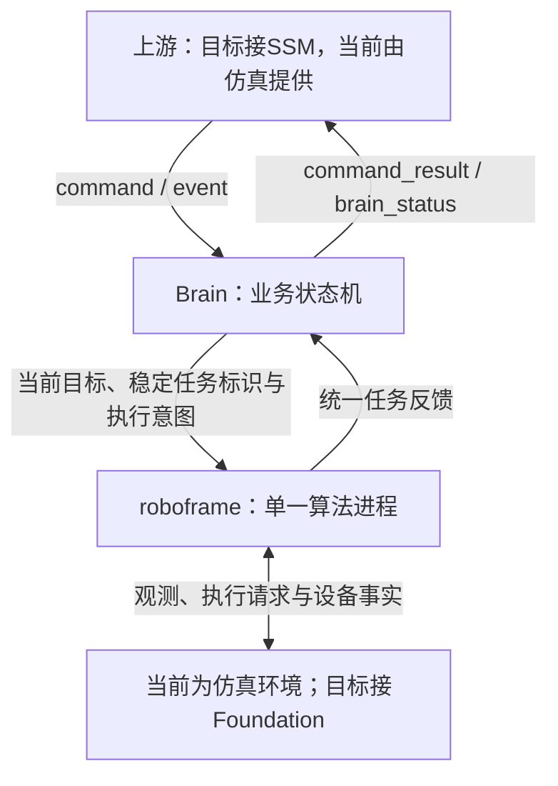

# robotic-mower

当前阶段：**Brain 对接单一 roboframe 的业务原型**。使用独立场景验证建图、割草、回充与恢复；实际算法和设备尚未接入。

```text
robotic-mower/
├── brain/          完整业务逻辑、任务顺序、业务进度和恢复决策
├── contracts.py    JSON 控制协议及最小内部值类型
├── docs/           当前架构基线、重构记录；history/ 仅存历史方案
└── simulation/     算法替身、交互脚本、回归和离线回放
```

系统职责见 [SSM、Brain 与 foundation 的边界](SYSTEM_DESIGN.md)。SSM 是 Brain 的上游，负责系统许可与命令转交；Brain 是业务决策中心。根据 2026-10-12 的架构确认，原先 perception、map_manager、pnc 三个算法进程合并到 roboframe 的单一算法进程，算法侧仍保留各能力职责边界。Brain 职责基本维持，继续管理任务顺序、业务进度、中断与恢复。SSM/foundation/HMI/App 尚未接入原型。

## roboframe 工作区与集成边界

当前算法组件关系与职责见 [roboframe 架构讨论基线](docs/ROBOFRAME_ARCHITECTURE_BASELINE.md)：保留原有八项主体，新增 CoverageManager、BladeComponent 和充电桩感知，明确 Controller 对桩模式及配套、可选能力和待定边界。Brain 保留业务决策，CoverageManager 管理某次任务的空间进度；这是目标架构讨论基线，不代表能力已经实现或接口已经定稿。

早期 Server V1、算法架构 V2 已归入 [历史方案](docs/history/README.md)，仅供追溯，不作为当前实施依据。

- 实际工作区：WSL2，发行版 `Ubuntu-22.04`，目录 `/home/watermango/work/roboframe`。
- GitHub 仓库：[PU-UP/roboframe](https://github.com/PU-UP/roboframe)，已核实 origin 为 `https://github.com/PU-UP/roboframe.git`。
- roboframe 的产品进程为 `robot_runtime`；算法组件由 integration 装配、接线和编排，组件内部负责算法计算。组件可以独立开发，部署在同一进程内不等于单线程，也不要求一个职责目录对应一个组件。
- Brain 继续负责业务决策；roboframe 承接当前目标所需的算法执行。内部 BT 协调当前任务执行，生产接口接入仍待明确，本次进程合并不把 Brain 的业务决策职责转移给算法组件。
- 本仓库继续用于 Brain 协议、业务状态机与交互仿真。旧三个产品目录已撤去，有用数据模型移至 `simulation/world.py`、`observation.py`、`planning.py`；单一 `RoboframeDouble` 提供统一任务反馈，当前尚未连接实际 roboframe。

## 当前原型接口

Brain 不再等待三个算法来源或调度区域内沿边/覆盖步骤。区域顺序、低电抢占和恢复在 Brain；当前任务内部执行、空间进度与设备确认在 roboframe。重构范围和验收见 [计划记录](docs/BRAIN_ROBOFRAME_REFACTOR.md)。



下发示例：

```json
{
  "revision": 4,
  "task_id": "work-1",
  "mode": "WORKING",
  "phase": "EXECUTE",
  "mission": {"type": "MOW_REGION", "map_id": "garden", "target_id": "region-2", "control": "AUTO"}
}
```

完整定义见 [Brain 输入输出协议](brain/PROTOCOL.md)。完整目标顺序只留在 Brain；原任务标识随恢复请求继续传给 roboframe，使空间作业记录可以关联续用。原型协议已替换旧三来源反馈，尚不是生产协议定稿。

运行（项目根目录，Python 3.11+）：

```powershell
.\.venv\Scripts\python.exe -m simulation
.\.venv\Scripts\python.exe -m simulation --script simulation/scenarios/cover_regions.json
.\.venv\Scripts\python.exe -m unittest discover -s simulation -p "test_*.py" -v
```

新环境先安装依赖：

```powershell
python -m venv .venv
.\.venv\Scripts\python.exe -m pip install -r requirements.txt
```

打开 [交互回放](simulation/output/report.html) 查看单一 roboframe 交互图、本步 JSON、模块基本状态和验收结果。仿真支持自动算法反馈和脚本指定反馈，格式见 [仿真说明](simulation/README.md)。

后续你提供一项业务，就增加一份独立的交互脚本，填入输入与期望输出，再迭代 brain；目前不提前规定全部业务策略。

仿真用固定线段和明确的刀盘反馈验证有效作业记录，用独立设备事实验证充电确认；这些是内存替身，不是实际 CoverageManager、刀盘控制或对桩算法。空间记录不会写入环境地图，新任务不继承旧覆盖。无业务/覆盖掉电恢复、可靠地图提交或实机运动保证。

首个业务已接入：[整次建图流程](brain/MAPPING.md)，包含从充电站后退1.5米、遥控回归通道、两区域与普通通道、接管恢复、闭合和连通校验后保存。运行 python -m simulation，在总报告中切换建图、作业、回充和异常场景。

仓库使用 main 分支。源码、协议文档和仿真场景纳入版本管理；.venv、缓存和 simulation/output 生成文件不提交。克隆后按上述步骤运行即可重新生成回放页面。
