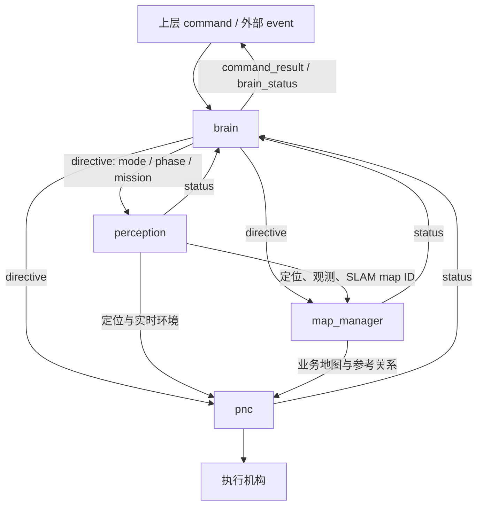

# robotic-mower

当前阶段：先设计 **brain 的输入输出与业务状态机**，用独立交互场景迭代；算法逐个业务替换模拟实现。

```text
robotic-mower/
├── brain/          完整业务逻辑、任务顺序、业务进度和恢复决策
├── perception/     感知定位与内部 SLAM 数据
├── map_manager/    业务地图管理及 SLAM map ID 对齐
├── pnc/            当前目标的规划与控制
├── contracts.py    JSON 控制协议及最小内部值类型
└── simulation/     算法替身、交互脚本、回归和离线回放
```

brain 最上层，下面三个模块平行：



下发示例：

```json
{
  "revision": 4,
  "mode": "WORKING",
  "phase": "EXECUTE",
  "mission": {"type": "COVER_REGION", "map_id": "garden", "region_id": "region-2"}
}
```

完整定义见 [Brain 输入输出协议](brain/PROTOCOL.md)：模块 status、上层 command、外部 event、命令回执与业务状态。任务历史、完整目标顺序只留在 brain；PNC 接收当前目标与实时算法输入，没有跨任务历史依赖。

运行（项目根目录，Python 3.11+）：

```powershell
.\.venv\Scripts\python.exe -m simulation
.\.venv\Scripts\python.exe -m simulation --script simulation/scenarios/cover_regions.json
.\.venv\Scripts\python.exe -m unittest discover -s simulation -p "test_*.py" -v
```

新环境先安装依赖：

```powershell
python -m venv .venv
.\.venv\Scripts\python.exe -m pip install -r requirements.txt
```

打开 [交互回放](simulation/output/report.html) 查看固定模块交互图、本步 JSON、模块基本状态和验收结果。仿真支持自动算法反馈和脚本指定反馈，格式见 [仿真说明](simulation/README.md)。

后续你提供一项业务，就增加一份独立的交互脚本，填入输入与期望输出，再迭代 brain；目前不提前规定全部业务策略。

当前下层包只定义最小数据产品，真实算法未实现。续作保留已完成目标，被打断目标重新执行；无精确轨迹续作、业务历史掉电恢复、可靠地图提交或实机运动保证。SLAM 与业务地图 ID 对齐目前只声明/校验参考关系，没有坐标变换算法。

首个业务已接入：[整次建图流程](brain/MAPPING.md)，包含两区域、一通道、遥控接管、闭合通知和最终保存。运行 python -m simulation --scenario mapping 查看独立验证。

仓库使用 main 分支。源码、协议文档和仿真场景纳入版本管理；.venv、缓存和 simulation/output 生成文件不提交。克隆后按上述步骤运行即可重新生成回放页面。
