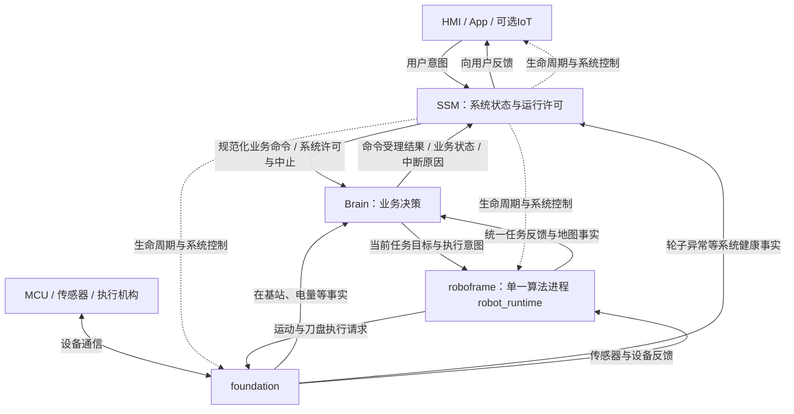

# 系统职责参考架构：SSM、Brain 与 Foundation

2026-10-30 定位：本文是持续维护的系统职责参考架构，来源于入职前讨论，后续可根据产品经验升级。SSM、Brain、Foundation 是参考设计中的逻辑角色，不直接等同 rlcp 现有目录或进程；首款产品现状见 [rlcp 基线](docs/RLCP_BASELINE.md)。

原 Python 原型已退役，不能作为当前实现或接口已落地的证据。以下职责为参考方案，产品采纳或调整时需明确实现位置与验证依据。

## 1. 设计结论

SSM 是系统“心脏”：管理系统运行状态和模块生命周期，处理影响整机运行的健康问题，决定是否允许 Brain 执行业务。Brain 是业务决策中心：接收 SSM 转交的用户意图，结合可信、有效的事实判断能否开始、如何推进、如何中断及恢复业务。

同一份事实可以被多个模块订阅，但每一条规则只有一个决策所有者。能获得“在基站”和“开始建图”两条信息，不意味着 SSM 应判断“无图建图必须从基站开始”。这条限制属于建图业务，唯一所有者是 Brain。

HMI 与 App 是否包含彼此、App 中间是否经过 IoT，不改变 Brain 的业务接口。对 Brain 而言，SSM 是上游命令入口和回执接收方。

原先 perception、map_manager、pnc 三个算法进程合并为 roboframe 的单一产品进程 `robot_runtime`。Brain 的业务职责基本维持；感知定位、业务地图管理、规划控制仍是算法侧的逻辑职责，不因同进程而合并数据所有权或决策权限。roboframe 的 integration 负责组件装配、跨组件对时与数据分发、算法任务编排；算法计算归组件，跨业务任务的顺序、进度与恢复决策仍归 Brain。内部 BT 协调当前任务，空间覆盖、地图资产与设备状态各有所有者；具体组件实现和生产接口待设计。

当前进一步确认的目标职责：Brain 管业务任务、区域顺序、暂停、回充和恢复，CoverageManager 独立管理某次割草任务的空间进度；BT 协调执行，BladeComponent 解释刀盘执行反馈，充电桩感知向 Controller 的对桩模式提供实时观测，不新增独立对桩组件。长期充电站资产归地图管理，实际接触、在桩与充电事实来自设备侧。设备反馈能力尚待核实，不能把刀盘命令发出或视觉对准当作实际运行、在桩或充电已确认；这些目标能力尚未接入原型，详见架构讨论基线。

roboframe 实际工作区为 WSL2 `Ubuntu-22.04` 中的 `/home/watermango/work/roboframe`，仓库为 [PU-UP/roboframe](https://github.com/PU-UP/roboframe)。本仓库维护设计讨论与产品对照；工作区关系见 [README](README.md#工作区与代码关系)。

## 2. 逻辑信息流

下图保留系统级逻辑职责视图；roboframe 内部当前讨论的组件架构、能力职责与待定项见 [架构讨论基线](docs/ROBOFRAME_ARCHITECTURE_BASELINE.md)。Brain 通过 roboframe 的统一任务入口对接，内部组件关系不在系统图展开。

roboframe 框表示已确定的单算法进程边界；内部组件详见架构基线。箭头表达逻辑依赖，Brain 的实际接入由 roboframe 产品入口承接，具体消息协议仍待设计。图不确定其他模块的进程组合。foundation事实可以直接订阅，也可由中间层透明转发，但必须保留来源、采样时间和有效性，不能转发成由SSM替Brain作出的业务结论。执行侧必须受系统停止/禁止运动约束；具体执行链和安全停机机制待实机设计。

## 3. 唯一决策所有者

| 问题 | 所有者 | 其他模块职责 |
| --- | --- | --- |
| Brain进程是否存活，模块能否启动、停止、重启 | SSM | 模块提供健康事实，Brain报告业务状态 |
| 轮子异常是否禁止整机运动，系统许可是否撤销 | SSM | foundation检测/报告设备事实并执行系统约束；Brain保留中断上下文 |
| 用户请求如何接入并交给Brain | SSM | HMI/App提交意图；SSM规范化、关联请求、检查系统许可，不改写业务规则 |
| 机器人是否在基站 | foundation提供传感器事实 | Brain缓存并检查事实有效性；不得以地图坐标靠近站点替代真实在桩证据 |
| 无图情况下是否允许开始建图 | Brain | 结合地图存在性与在桩事实；SSM只传命令和结果 |
| 是否已有可用业务地图 | roboframe地图管理提供事实 | Brain用于业务准入；地图模块维护权威地图版本和有效性 |
| 自动后退1.5m、接管、闭合后提交、保存失败后怎么处理 | Brain | roboframe统一报告执行结果；内部控制、地图与定位组件提供证据 |
| 通道端点是否属于不同区域，全图是否连通 | roboframe地图管理 | Brain决定何时请求校验及收到结果后如何推进；不做几何计算 |
| 低电是否挂起作业、改为回充 | Brain | foundation提供电量事实；SSM仍可因独立系统健康规则禁止运动 |
| 定位失效时当前动作能否继续 | 算法模块本地停止；Brain处理业务中断 | SSM独立判断是否需要系统级降级或停止，不替Brain选下一业务阶段 |

“系统健康”与“业务能力”不等同。进程活着但定位不可用，可以是SSM运行许可仍有效、Brain当前导航不可执行。轮子故障可以是定位仍可用、SSM撤销整机运动许可。两者共同约束执行，任何一方都不能替另一方放行。

## 4. 以首次无图建图为准入示例

目标规则：无图情况下，只有有效事实确认机器人在基站，Brain才接受开始建图。地图事实未知不能当作无图，在桩事实过期或未知不能当作已在桩。

1. App/HMI发出START_MAPPING，由SSM解析为业务命令并保留请求关联标识。
2. SSM检查系统运行许可。系统故障时由SSM拒绝转交，反馈系统原因；通过只表示允许交给Brain，不代表建图已经受理。
3. Brain检查自身业务状态、低电等已有门槛，并读取有效的地图存在性与foundation在桩事实。
4. 无图且有效在桩：Brain返回业务ACCEPTED，建立建图Mission，进入UNDOCK/PREPARE。事实缺失、过期、非在桩或业务冲突：返回明确业务拒绝原因，保持原业务上下文，不先创建失败Mission。
5. 模块准备确认、实际退桩执行与测量仍由下层完成；如果受理后条件失效，按准备或执行失败处理。受理检查不替代执行前和执行中的检查。
6. SSM把Brain结果交还用户。命令接受、动作开始、业务完成是三个不同结果，不混用。

在桩是这条业务的启动前置条件，不是退桩之后仍需一直成立的条件；退桩时离桩是预期变化。事实的使用范围和有效期由业务阶段定义。

当前只明确了“无图”的规则；已有地图时新建、重建、追加建图是否允许以及是否同样要求从基站出发，尚未定义，不自动扩展或放宽。

## 5. 输入、健康与恢复边界

目标输入有三类，逻辑上分开：

- **业务命令**：SSM → Brain，表达用户意图；Brain返回业务受理和结果。系统层拒绝与业务层拒绝保留各自来源，支持请求关联。
- **系统许可/中断**：SSM → Brain。撤销后不允许业务继续输出可执行动作；Brain暂停还是失败、保留什么恢复点，由中断语义和业务阶段决定。Brain失联时SSM及执行侧仍能停止机器，不能依赖Brain回执完成系统停机。
- **事实输入**：foundation、地图和算法模块 → Brain。至少定义来源、值、采样时间、有效性；未知与false区分。Brain Health/Event Manager负责缓存与时效，Mission消费事实作业务判断。具体字段、频率、重启隔离和丢失处理后续协议设计，不在本步假定已存在。

SSM恢复系统许可不自动恢复任务；Brain本地RESET_ERROR也不能恢复SSM已经撤销的许可。后续恢复至少同时满足系统许可、业务前置条件和显式恢复规则。系统中断的可恢复性、COMMIT未决结果和强制停机优先级需在接入协议时定义，不能直接把现有用户PAUSE/CANCEL当系统强停：它们在COMMIT期间会被拒绝。

Brain内部的Health/Event Manager仅负责业务相关事实与能力，不承担整机看门狗。SSM可以订阅同样的模块健康，但仅执行系统策略；跨层故障使用可关联的来源和原因，不靠两个模块分别猜测根因。

## 6. 产品应用与设计演进

首款产品以 [rlcp 实际架构](docs/RLCP_BASELINE.md) 为基线。监控、硬件抽象、业务决策在现有实现中的职责需要逐项对应，不因参考图存在 SSM/Foundation 就新增同名服务或改变部署。

旧原型暴露的系统许可、事实来源、业务准入、停止确认和恢复语义仍是设计问题，但其 JSON 协议、固定建图阶段及显式续作规则不再作为产品约束。相关职责分析保存在 [Brain 历史设计](docs/history/BRAIN_PROTOTYPE_DESIGN.md)。

后续更新本参考架构时，区分产品已验证行为与待采纳设计，并记录选择理由。业务与算法代码、设备适配和可执行验证归实际代码仓库；本仓库维护跨模块结论。
