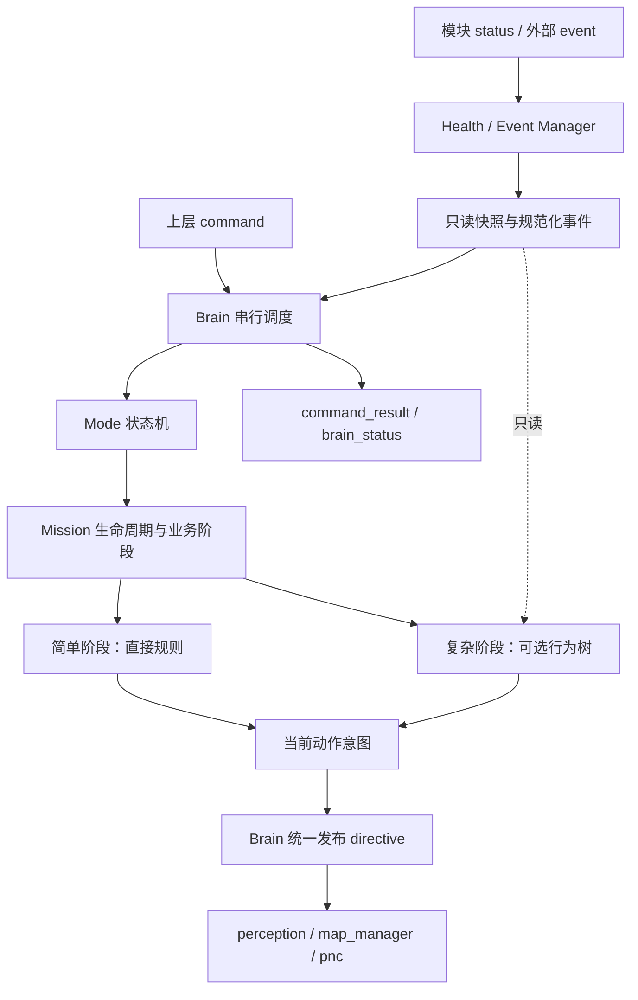
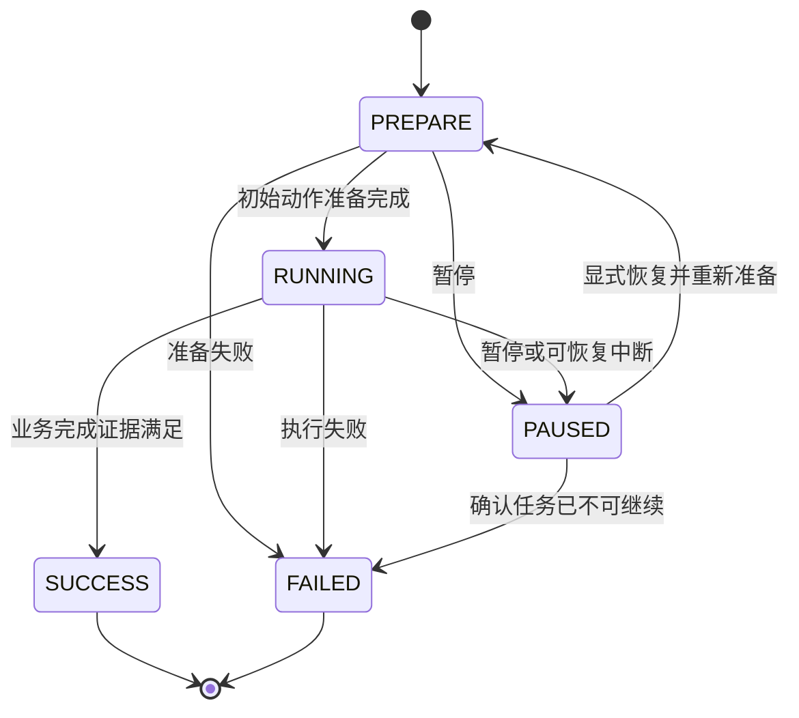

# Brain 设计：分层状态机 + 按需行为树

状态：按已确认的架构方向制定的设计，尚未改造运行代码。现有协议与实现仍以 [PROTOCOL.md](PROTOCOL.md) 为准；本文中的内部类型、Health 结论与新增观测字段是后续实现目标。

Mode 决定大业务，Mission 状态机决定任务做到哪一步，行为树决定当前阶段这一刻做什么。独立的 Health / Event Manager 整理模块事实，业务层读取稳定的结论。实现以简洁、确定性、可单独测试为优先。

## 1. 结构与决策权



| 部分 | 拥有的状态与决策 | 边界 |
| --- | --- | --- |
| Mode 状态机 | 当前业务模式、完整任务顺序、挂起任务、模式切换 | 不判断沿边的单步动作 |
| Mission 状态机 | 生命周期、业务阶段、恢复点、任务结果 | 不解释各模块所有底层错误 |
| 行为树（可选） | 当前阶段内的条件选择和动作运行状态 | 不切换 Mode，不直接结束整个 Mission |
| Health / Event Manager | 模块缓存、新鲜度、能力融合、事件去重、原因证据 | 不决定换业务、重试或自动恢复 |
| Brain 调度与输出 | 固定处理顺序、回执、revision、发布与快照 | 唯一能对外发 directive 的位置 |

这些是职责分层，不是多个进程。首版一个 Brain 实例、一个串行调用路径即可。时间由外部传入，核心不访问真实时钟、网络、文件或算法实例。位姿、地图、障碍物和轨迹仍在下层流转。

## 2. 第一层：Mode

内部 Mode 使用 `IDLE / MAPPING / WORKING / RETURN_TO_CHARGE / CHARGING`。

暂停属于 Mission 生命周期；故障由 Health 事实、故障锁存及 Mission 结果表达。例如建图暂停后仍是 mode=MAPPING、mission.lifecycle=PAUSED。故障锁存可以在没有 Mission 的 IDLE 下存在并阻止启动，因此不能只用 Mission FAILED 表达整机故障。

| 触发 | Mode 行为 |
| --- | --- |
| IDLE 收到开始建图/割草/回充 | 建立对应 Mission，进入 MAPPING / WORKING / RETURN_TO_CHARGE |
| 当前覆盖区域成功 | 还有区域则创建下一覆盖 Mission；全部完成则 IDLE |
| 整次建图保存成功 | 记录会话结果，进入 IDLE |
| 回充 Mission 成功 | 进入 CHARGING；到站成功证据由 PNC 提供 |
| WORKING 收到低电 | 保留已完成区域和恢复点，中断当前执行，进入 RETURN_TO_CHARGE |
| 充电完成且有挂起任务 | 回到 WORKING，Mission 为 PAUSED，等待显式 RESUME |
| 充电完成且无挂起任务 | IDLE |
| 允许取消时收到 CANCEL | 终止执行，记录 cancelled，清除当前与挂起上下文，进入 IDLE |

Mode 负责切换，Mission 只报告结果。首版仅允许一份挂起割草任务，不引入通用抢占栈。主动 RETURN_HOME 沿用当前仅从 IDLE 发起的策略。建图低电暂停会话，提交中的处理见第 5 节。

## 3. 第二层：Mission 生命周期与业务阶段

先区分三个概念：

- **Task**：用户完整业务请求，例如割草区域 A、B、C。Mode 层持有顺序与进度。
- **Mission**：有明确结束条件和恢复上下文的执行单元。首版为单区域覆盖、一次回充、整次建图会话。
- **Action**：Mission 当前交给下层的目标，例如区域自动沿边、手动采集、提交对象。现有 directive.mission / WorkItem 承担这一职责，暂保留线上的名字。

同一时间只有一个活动 Mission。建图中的区域和通道用业务阶段及对象 ID 表达，暂不嵌套子 Mission。

生命周期统一为 `PREPARE / RUNNING / PAUSED / SUCCESS / FAILED`。



SUCCESS / FAILED 是本次执行的终态。故障恢复保留业务恢复点，但 RESET_ERROR 只清锁存；之后显式 RESUME 创建新执行尝试并进入 PREPARE，不把同一次 FAILED 改回 RUNNING。复位后用 PAUSED 的待重试上下文等待用户，新尝试产生新控制版本。取消是独立结果 cancelled，终止并移除活动执行，不冒充成功或失败。

生命周期表示整个 Mission 的状态，业务阶段表示它进行到哪里，下层 phase 表示当前 Action 的准备、执行或提交。这三者不能共用一个 phase 字段。

| Mission | 业务阶段示例 | 完成条件 | 实现 |
| --- | --- | --- | --- |
| 覆盖单区域 | COVER | 当前区域对应的 PNC SUCCEEDED | 小状态机 |
| 回充 | NAVIGATE_TO_DOCK | 当前回充对应的 PNC SUCCEEDED | 小状态机 |
| 整次建图 | WAIT_START、BUILD_BOUNDARY、BUILD_CHANNEL、COMMIT_OBJECT、SAVE_MAP | SAVE_MAP 对应的 map_manager SUCCEEDED | 状态机；BUILD_BOUNDARY 按需使用行为树 |

WAIT_START 允许遥控转场；SELECT_REGION_START 进入 BUILD_BOUNDARY；闭合进入 COMMIT_OBJECT，提交成功才记录对象并返回 WAIT_START。通道从 WAIT_START 发起，FINISH_CHANNEL 后提交。FINISH_MAPPING 仅在无未完成对象且至少一个区域已提交时进入 SAVE_MAP。

进入新业务阶段或切换控制源，可以只让 Action 重新 PREPARE，Mission 仍为 RUNNING。Mission PAUSED 时保存业务阶段和目标，停止 Tick 行为树；恢复先重新获取当前 Action 的就绪确认。覆盖仍采用目标级恢复：保留已完成区域，当前未完成区域重新执行。

## 4. 第三层：按需行为树

行为树只在 Mission 的复杂阶段内存在。输入为本次决策的只读 Brain 快照，输出为动作意图及 `RUNNING / SUCCESS / FAILURE` 节点结果。节点 SUCCESS 只表示节点完成，Mission 根据业务证据决定是否换阶段或结束任务。

简单 Mission 直接返回 Action，不包装成树。先遵守输入输出边界，在第一个复杂阶段确实需要时实现所需节点或采用合适库，不提前建设通用行为树框架。

建边界阶段的候选树：

```text
ReactiveSelector（每次 Tick 从高优先级重新检查）
├─ Sequence：当前所选动作不可用 → 请求停止并报告中断原因
├─ Sequence：已确认区域闭合 → 请求提交对象
├─ Sequence：control_intent == MANUAL → 执行手动采集动作
└─ Sequence：control_intent == AUTO → 执行自动沿边动作
```

这是业务调度；真正的沿边算法仍在 PNC。Mission 验证树输出的阶段转换请求，树不自行提交地图。

TAKE_OVER 把 Mission.control_intent 设为 MANUAL；START_EDGE_FOLLOW 设为 AUTO。意图保存在 Mission 中，不只是一帧事件，避免下一 Tick 又回到自动。闭合事实也保留到阶段转换消费，不能因 Tick 时机而错过。

运行分支改变时先 halt 旧分支，清除其运行状态，再由统一输出发出新 Action / PREPARE；三模块本版本就绪后才 EXECUTE。halt 终止本地行为，不等于机器人已物理停下。叶节点不能直接调用模块或自行发布指令。

每个 Tick 有界且非阻塞；长动作通过后续反馈保持 RUNNING，不能在节点里 sleep、查询模块或循环等待。相同动作持续 RUNNING 时不重复增加 revision、不重复初始化。每个决策周期只提交一个最终控制意图。

## 5. Health / Event Manager

它是 Brain 内的独立组件，输入模块 status、外部事实事件和 now；输出不可变或深度隔离的快照及已去重的规范化事件。上层 command 仍走命令解析，不作为健康事实。

首版复用现有 status、LOW_BATTERY / BATTERY_OK 和 REGION_CLOSED，不新增模块事件通道；确有无法表达的事件时再扩展协议。

| 输出 | 含义 |
| --- | --- |
| modules | 最新有效模块事实、接收时间、新鲜度与原始原因，供诊断 |
| 当前 Action 的确认 | 仅当前 revision 的 READY、完成与闭合证据，换版本清空 |
| capabilities | navigation、manual_drive、mapping、map_commit 各自的 AVAILABLE / DEGRADED / UNAVAILABLE |
| causes | 原因码、来源、发生时间、依赖关系与支撑证据 |
| events | 规范化后的低电、闭合、动作完成等事实，消费一次 |

能力按当前动作需求计算，不用一个全局 degraded 代替所有能力。例如自动沿边需要导航与建图能力，手动采集需要手动控制与建图能力；是否依赖有效定位由模块职责约定决定，不能默认手动可绕过定位故障。map_commit 单独评价保存能力。

首版融合采用显式规则：

1. 缺少有效证据或必需依赖过期，能力为 UNAVAILABLE，原因区分未知和过期。
2. 必需依赖 FAILED / BLOCKED / REJECTED 时产生能力限制与原因；业务拒绝仍由 Mission 解释，例如通道起点在区域外只拒绝本次开始操作。
3. DEGRADED 仅用于已有明确证据且定义了允许动作的降级情形。现有协议没有此类证据时，不猜测降级，也不默认放行自动执行。
4. 导航不可用与地图保存能力可取不同值。定位失效导致 PNC 阻塞时，有依赖证据才关联原因；独立故障并列保留，不凭最早上报猜根因。

Health 提供事实，Mission 根据阶段决定暂停、失败或允许的降级动作，Mode 决定是否换业务。能力恢复不自动清除故障锁存，也不自动恢复运动。

诊断缓存与动作确认分开：旧 revision 反馈可留诊断记录，但不能推进当前任务或恢复当前能力。现协议没有独立于 Action 的健康证据时，新版本等待新反馈，不能用旧 READY 推断就绪。未来增加能力证据时需同时定义新鲜度和作用范围。

建图 COMMIT 中低电先锁存，等待本次提交完成；对象提交成功后记入进度并 PAUSED，禁止重新开放遥控。最终 SAVE_MAP 成功可回 IDLE。普通 PAUSE / CANCEL 在 COMMIT 中继续拒绝；ERROR 中 CANCEL 仍需先 RESET_ERROR。真正模块故障或超时仍可中断业务，但提交结果可能未知；没有幂等提交/查询之前，不能假定重新提交安全。

## 6. 每次决策的固定顺序

保留 `receive(kind, payload, now)` 和 `tick(now)`。两者进入同一内部决策过程，receive 带一条输入，tick 只推进时间。输出形状暂与现接口一致，tick 的 Directive 由宿主序列化发布。

1. 校验时间与结构，检查本轮之前的截止时间，记录已发生的超时，避免新心跳覆盖旧时间戳后掩盖超时。
2. 更新 Health / Event Manager：过滤版本、序号、时间，缓存事实并生成本轮快照；本次新心跳不能抹去已经发生的超时。
3. 解析并去重命令/事件。重复命令返回原 ACK，不重复执行；独立的超时处理仍有效。拒绝的命令不能部分修改业务状态。
4. 优先应用故障锁存、低电和当前允许的暂停/取消规则，再由 Mode、Mission 处理转换。故障恢复仍需 RESET_ERROR 和显式 RESUME。
5. 仅对允许运行的阶段执行直接规则或 Tick 行为树；本轮读取同一份快照。
6. 校验最终动作与能力、阶段匹配，统一提交输出；只有控制意图变化才递增 revision，随后返回 ACK 与隔离的业务快照。

同一时刻的消息按宿主实际交付顺序逐条决策并记录，不等待未来消息重排。截止时间沿用 `elapsed > timeout`，等于阈值仍有效。revision 隔离不同执行，sequence 过滤同模块重复与倒序。

## 7. 与现有协议兼容

先实现内部分层，再通过单一输出映射保持下层协议。内部状态作为后续 brain_status 的增量观测字段，不让客户端从旧字段反推新模型。

| 新内部含义 | 现有线协议映射 |
| --- | --- |
| RETURN_TO_CHARGE | directive.mode=RETURNING |
| Mission PAUSED | directive.mode=PAUSED、phase=NONE、mission=null，内部保留业务 Mode |
| 锁存故障或 Mission FAILED | directive.mode=ERROR、phase=NONE、mission=null，内部保留 Mode 和恢复点 |
| Action 准备/执行/保存 | directive.phase=PREPARE / EXECUTE / COMMIT |
| 当前 Action | directive.mission，沿用 WorkItem 四字段 |
| Mission SUCCESS | 先记录结果，再由 Mode 选择下一 Mission 或空闲指令 |

映射优先级为故障停止高于暂停，高于正常 Action。IDLE / CHARGING 无 Action。现有 brain_status.mode / phase 继续反映线协议；计划新增 business_mode、mission_state（生命周期、业务阶段、执行尝试）、health，具体 JSON 形状在实施时连同协议测试定稿。

ACCEPTED 仍只表示受理，不代表准备完成、停车或任务成功。当前 revision 无跨重启 epoch，提交无可靠查询；这些不因引入行为树而自动解决。

## 8. 最小实现组织与迁移

| 位置 | 计划职责 |
| --- | --- |
| brain/__init__.py | Brain 入口、串行调度、Mode 转换、统一输出映射 |
| brain/health.py（新增） | Health / Event Manager、能力融合、快照 |
| brain/mission.py（新增） | 生命周期与业务函数，复用 Task / MappingSession 数据 |
| brain/behaviors.py（按需新增） | 首个复杂阶段实际使用的树与节点 |
| contracts.py | 保持下层协议；内部生命周期和能力枚举放在 brain 内 |

按职责拆少量文件，不建立插件系统、任务注册框架或独立服务。实施顺序：

1. 用现有场景固定外部行为，提取 Health 与快照隔离。
2. 区分内部 Mode、Mission 生命周期、业务阶段和 Action，增加兼容映射与观测。
3. 对确认复杂的阶段接入行为树，简单 Mission 保持直接规则。
4. 每个业务新增独立正常/异常场景；每步保持公开入口可运行。

超时后心跳补救、低电提交后重新开放遥控等现有问题，单独增加回归并修正，不把行为修正混同为纯结构迁移。

## 9. 测试与验收

沿用 unittest、SimPy 与 JSON 场景。直接注入时间和事实，不启动真实模块、不 sleep。相同初始状态与有序输入必须得到相同输出序列。

| 范围 | 重点验收 |
| --- | --- |
| Health | 缺失、过期、乱序、重复反馈；各能力独立融合；归因有证据；恢复不自动解锁；快照不泄漏可变引用 |
| Mode | 低电挂起/回充/充电恢复；暂停与故障不丢业务 Mode；完整目标仅在 Mode 层推进 |
| Mission | 生命周期转换；完成方确认；业务阶段与 Action PREPARE 独立；FAILED 重试是新尝试；取消独立结果 |
| 行为树（引入时） | 手动意图跨 Tick 保持；抢占后 halt；连续 RUNNING 不重复发指令；旧动作完成不结束新动作 |
| 协议 | 原消息兼容；旧版/重复反馈不推进；内部状态映射一致 |
| 完整业务 | 建图两区域一通道、接管/恢复、低电提交后暂停、割草续作、故障显式恢复 |

首轮新增三个边界用例：超时后新心跳不能补救已发生的超时；建图提交期间低电，成功后只计一次进度并暂停；调用方修改快照不污染 Brain。行为树每新增一个可抢占动作，都需验证中断和重新进入。

本阶段只更新设计。实机时钟、持久化、跨重启隔离、停车确认及提交结果不确定性在真实模块接入时另行设计，Health 与行为树不能替代这些机制。
