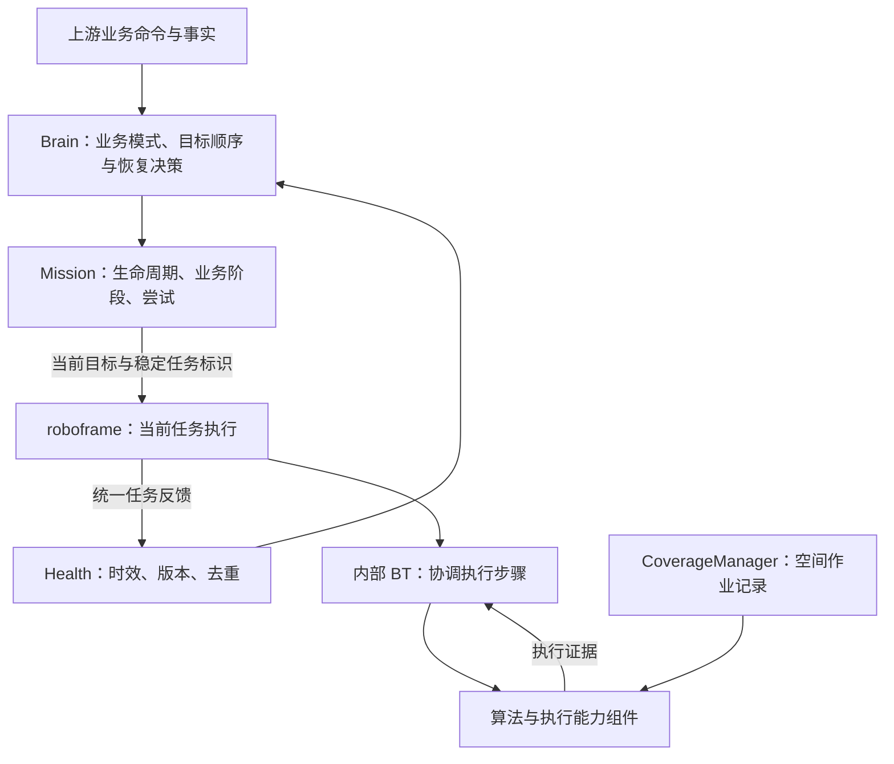

# Brain 设计：业务状态机与单一 roboframe 边界

状态：2026-10-14。本文描述本仓库的可执行 Python 原型；实际算法工作区尚未接入。目标组件关系以 [roboframe 架构基线](../docs/ROBOFRAME_ARCHITECTURE_BASELINE.md) 为准，原型消息见 [协议](PROTOCOL.md)。

## 职责与状态所有者

| 位置 | 状态与决策 | 边界 |
| --- | --- | --- |
| Brain / BusinessMode | 业务任务、区域顺序、启动、低电抢占、暂停、取消、回充后恢复 | 不决定区域内沿边与覆盖切换，不计算地图或覆盖几何 |
| Task | 完整区域序列、已完成区域、当前目标；最多一份挂起作业 | 不保存空间覆盖记录 |
| MissionExecution | 生命周期、当前业务动作、执行尝试、失败结果 | 任务内运动步骤归 roboframe |
| MappingSession | 用户建图阶段、控制意图、已提交对象 ID、保存及业务拒绝处理 | 不计算闭合、连通性、轨迹或地图落盘 |
| HealthEventManager | roboframe 反馈、时效和版本屏障、事件去重、低电事实 | 不推断内部各组件能力，不承担 SSM 整机看门狗 |
| roboframe integration / BT | 当前任务准备与执行，内部步骤和允许范围内的重试 | 不接管跨任务决策，不是地图、覆盖记录、设备状态的唯一所有者 |
| CoverageManager / 地图管理 / BladeComponent | 各自长期或执行状态 | 在 roboframe 内独立于 BT 的短期运行状态保存 |

原 `perception/`、`map_manager/`、`pnc/` 产品包已撤去；其中有用的数据模型迁到 simulation。Brain 无算法实例依赖，时间由调用方传入。

## 三类业务如何分工

**建图**：Brain 保留整次会话，接受选择区域、沿边、接管、开始/结束通道与最终保存等用户意图。roboframe 负责退桩执行、定位与采集、闭合检测、几何校验和地图提交。闭合反馈与提交完成是两个不同确认；对象提交不等于整张地图保存。现有 1.5 米退桩是仿真业务约定，不是统一硬件参数。

**割草**：Brain 每次下发一个 `MOW_REGION`，只有整个区域成功才推进区域顺序。roboframe 内部协调转场、沿边、覆盖与刀盘执行；Planner 同时消费环境地图、CoverageManager 作业记录、定位和目标。已割区域仍可通行，覆盖记录不写入环境地图。暂停或回充后，Brain 重新下发原任务标识和目标，roboframe 根据原任务剩余范围重新规划。Brain 不下发独立 EDGE_REGION / COVER_REGION。

**回充**：Brain 决定何时回充和充好后恢复什么；roboframe 内部 BT 协调导航到接近区、Controller 对桩模式、实时桩感知、结果确认与允许的重试。长期桩资产归地图管理。整个回充的成功语义包含设备侧充电确认，导航抵达或视觉对准不足以报告成功。

本轮没有在 Brain 添加行为树，也没有实现真实 roboframe BT。仿真替身中的小状态分支仅用于验证上述边界，不作为生产 BT 设计。

## 状态分层与恢复

业务模式为 `IDLE / MAPPING / WORKING / RETURN_TO_CHARGE / CHARGING`。暂停和故障保留所属业务；对外停止模式映射为 PAUSED 或 ERROR，回充映射为 RETURNING。

Mission 生命周期为 `PREPARE / RUNNING / PAUSED / SUCCESS / FAILED`；Action 使用 `PREPARE / EXECUTE / COMMIT`。建图接管会让 Action 重新准备，但 Mission 可仍为 RUNNING。失败尝试保持 FAILED；RESET_ERROR 只清本地锁存并允许重试，RESUME 才创建 attempt+1。普通暂停恢复不增加 attempt。取消记录 cancelled，不冒充成功。

一般恢复重新 PREPARE；COMMIT 失败复位后恢复仍重发 COMMIT，旧 revision 的成功不能确认新尝试。内存替身支持幂等对象提交，真实提交查询、持久化和结果未知处理仍未实现。

低电时，作业 Task 连同任务标识和当前区域进入 suspended；回充是另一份任务。BATTERY_OK 恢复原上下文但保持暂停，仍需显式 RESUME。建图低电只暂停；COMMIT 中先记低电，待对象提交成功或可恢复业务拒绝后暂停，最终 SAVE_MAP 成功可回 IDLE。普通 PAUSE/CANCEL 不打断未决 COMMIT。

## 反馈与事件处理保障

1. 检查单调时间与已有截止时间，先判已发生的超时；新的心跳不能掩盖之前失联。超时当次普通命令拒绝，后续才可 RESET_ERROR。
2. 仅接受 roboframe 当前 revision、未早于下发时间、新鲜且未超前的状态；sequence 递增，stamp 不倒退。
3. 当前 READY 允许 PREPARE 进入 EXECUTE。成功只有在对应业务阶段才推进；失败、受阻及通用拒绝锁存故障。建图起点/连通校验拒绝保留会话供修正。
4. 命令与事件按 ID 去重，相同输入返回原回执，不重复执行；冲突 ID 拒绝。重复命令仍不能跳过超时检查。
5. 输出统一递增 revision，清当前动作确认缓存；历史诊断可保留但不能充当新动作证据。返回快照隔离可变引用。

Health 的 `current_action` 只描述当前 roboframe 任务反馈是否有效；AVAILABLE 不是运行授权，也不代替 READY。无内部组件心跳、降级推断或跨组件根因推断。

## 系统边界与未完成事项

[SSM / Foundation 边界](../SYSTEM_DESIGN.md)继续适用：SSM 管系统许可和进程生命周期，Brain 管业务准入。本地 RESET_ERROR 不能解除系统禁止，系统许可恢复不自动恢复业务。

SSM 许可、系统强停、Foundation 在桩和地图存在性事实尚未接入。无图建图应由 Brain 在受理前检查有效在桩与地图事实；当前替身在开始后检查固定坐标，仍是已知缺口。未知事实不能被解释为已确认；普通 PAUSE/CANCEL 也不能代替系统强停。

仿真仅用内存中的固定作业线段验证任务身份、实际运动与刀盘反馈共同计数，以及剩余记录续作。不验证真实覆盖率、位姿回环修正、地图版本迁移、设备反馈时效或掉电恢复。真实覆盖格式/持久化、刀盘可用反馈、对桩控制与重试边界仍待设计。
