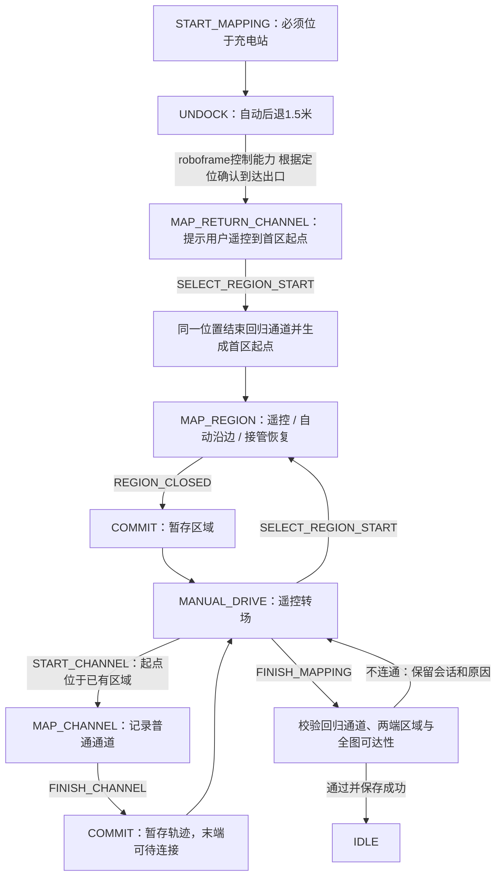

# 建图：充电站、回归通道与区域连通

整次建图是一份会话；对象提交只暂存工作地图。只有 FINISH_MAPPING 校验通过并收到地图模块保存成功，才结束会话。

## 系统职责补充

目标规则来自[系统设计](../SYSTEM_DESIGN.md)：SSM检查系统许可并转交建图命令，Brain读取foundation在桩事实和地图存在性事实，在受理前判断无图情况下是否允许建图。未知/过期事实不得放行。本文的仿真目前先创建UNDOCK、由下层检查固定站位，这是待调整的实现，不代表业务准入归地图模块。已有地图的新建/重建准入尚未定义。

## 首次出发与回归通道

开始建图先下发 UNDOCK / AUTO，目标为充电站。出口由充电站位置和朝向确定，位于车尾方向1.5米。roboframe控制能力 基于定位确认到达出口，不能仅凭经过一段时间报告完成。提前选择区域起点会被拒绝。

完成后进入 MAP_RETURN_CHANNEL / MANUAL，提示用户遥控到第一个区域起点。回归通道记录这段遥控轨迹，首点为退桩出口；自动后退段单独由充电站与出口几何表示，不混入遥控轨迹。

用户用 SELECT_REGION_START 确认到达并指定区域 ID。地图模块使用同一个定位点结束回归通道、生成第一个区域起点，不需要再采集另一份起点。回归通道 station_id 指向充电站，end_region_id 指向第一个区域。当前保留 dock、return-channel 两个对象 ID。

## 普通通道必须连接两个不同区域

START_CHANNEL 时，起点必须位于已建区域内，边界也算区域内。否则地图模块返回 REJECTED / CHANNEL_START_OUTSIDE_REGION，Brain 返回遥控转场并保留会话，允许调整位置重试。

允许“区域1 → 采集通道 → 建区域2”的顺序。FINISH_CHANNEL 只暂存轨迹；第二个区域未建好时 end_region_id 为空，是待连接草稿。区域提交后重新解析两端；普通通道起点和终点必须分别落在两个不同区域内。

最终保存统一校验：存在充电站及连接首区的回归通道；每条普通通道两端已连接；所有区域均可沿通道从充电站到达。失败返回 CHANNEL_NOT_CONNECTED、REGION_NOT_REACHABLE 或回归通道错误，保留会话、草稿和拒绝原因，不误报保存成功。当前没有对象编辑命令，可补建缺少区域；修改已有错误边界需后续编辑接口，或取消后重建。

## 阶段与责任

新动作和控制权切换先 PREPARE，roboframe 汇总条件并确认当前版本 READY 后才 EXECUTE。接管保持同一区域起点和草稿。闭合只接受 MAP_REGION / EXECUTE 中 roboframe 的 REGION_CLOSED；仅 roboframe 当前提交版本的成功才推进已完成对象。重复、迟到反馈由 revision / sequence 过滤。

Brain 管理业务阶段、生命周期和操作结果；下文地图模块均指 roboframe 内部地图管理能力，负责几何、端点归属、连通性与保存结论；roboframe控制能力 执行当前动作和沿通道转场。普通 MANUAL_DRIVE 不记录轨迹；回归通道、边界和普通通道有各自明确的采集阶段。

## 仿真验收与实现边界

mapping_session 从充电站自动退1.5米开始，包含遥控回归通道、首区自动/接管/恢复、错误通道起点重试、普通通道、区域2和保存。通道末端为 (9,2)，区域2边界为 (8,0) 至 (12,4)，明确包含末端。

mapping_disconnected 刻意让区域2遗漏末端，验证最终保存被拒绝且会话保留。其他作业、回充、暂停、低电与故障场景共用连通底图；转场轨迹经过普通通道和回归通道。

当前站位、朝向和定位来自仿真；退桩位置按步推进，作业/回充路径按虚拟时间插值。区域内连接线仅为示意，不代表避障、覆盖规划、真实运动控制、SLAM 或可靠持久化已经实现。

运行 `python -m simulation` 生成全部场景，在总报告 `simulation/output/report.html` 切换场景和“Brain 内部 / 进程交互”视角。
