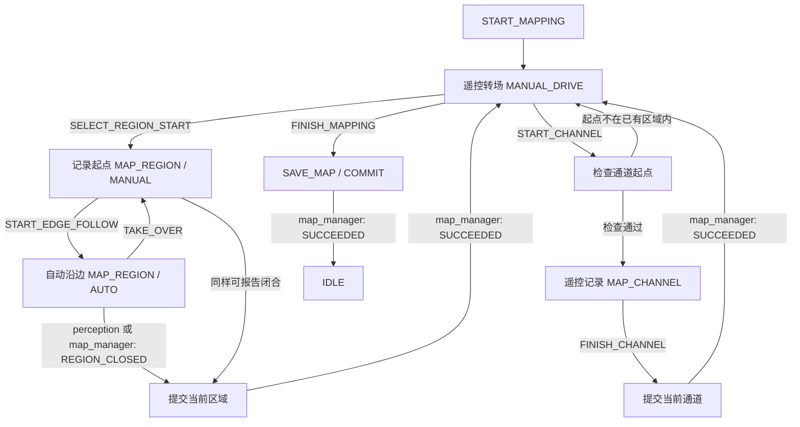

# 建图业务 01：两个区域与一条通道

整次流程是一份建图会话：区域/通道各自结束，但只有用户 FINISH_MAPPING 且保存成功才结束会话。



## 上层操作与下发目标

| 用户操作 | command.type / params | Brain 下发 mission |
| --- | --- | --- |
| 开始建图 | START_MAPPING / map_id | MANUAL_DRIVE / map_id |
| 遥控到第一块区域 | 摇杆数据走遥控与控制接口，不进入 brain | 保持 MANUAL_DRIVE |
| 选择区域起点 | SELECT_REGION_START / region_id | MAP_REGION / target_id / control=MANUAL |
| 开始或继续自动沿边 | START_EDGE_FOLLOW / 无 | 同一个 MAP_REGION，control=AUTO |
| 临时遥控接管 | TAKE_OVER / 无 | 同一个 MAP_REGION，control=MANUAL |
| 到达通道起点，开始通道 | START_CHANNEL / channel_id | MAP_CHANNEL / target_id / control=MANUAL，先 PREPARE 校验 |
| 遥控通道一段后点击结束 | FINISH_CHANNEL / 无 | 当前 MAP_CHANNEL / COMMIT |
| 遥控到区域2并重复区域操作 | SELECT_REGION_START / region-2 | 新 MAP_REGION，已有区域/通道保留 |
| 点击结束整次建图 | FINISH_MAPPING / 无 | SAVE_MAP / COMMIT |

新目标和控制权切换都先 PREPARE，三方新版本 READY 后才 EXECUTE。PNC 在 PREPARE 停止，确认完成切换后才允许对应控制源；command ACCEPTED 不代表控制权已切好。

自动沿边示例：

```json
{
  "revision": 6,
  "mode": "MAPPING",
  "phase": "EXECUTE",
  "mission": {
    "type": "MAP_REGION",
    "map_id": "new-garden",
    "target_id": "region-1",
    "control": "AUTO"
  }
}
```

接管只改变 control 和 revision，区域 ID、起点、草稿保持。当前按“接管期间继续记录遥控轨迹”实现；如果业务选择暂停记录，再调整该约定和验收。

## 闭合与提交

perception 或 map_manager 检测到回到起点后，发送当前 revision 的 status：

```json
{
  "module": "map_manager",
  "revision": 6,
  "sequence": 25,
  "stamp": 2.4,
  "state": "RUNNING",
  "signal": "REGION_CLOSED",
  "reason": null
}
```

Brain 只接受 MAP_REGION / EXECUTE 中来自这两个模块的闭合信号，转 COMMIT。只有 map_manager 的 SUCCEEDED 才把区域加入完成列表并返回 MANUAL_DRIVE。PNC 的 SUCCEEDED、旧 revision 的信号、通道中的闭合信号都不结束区域。

两个模块同时报告、重复报告或接管前消息迟到，由 revision/sequence 过滤。Brain 不读坐标、不自行算闭合。模拟 map_manager 要求轨迹离开起点、形成非零面积后再次靠近起点，避免选择起点即闭合。

## 通道起点约束

map_manager 使用会话中已经提交的区域草稿，在 PREPARE 校验通道的第一个定位点。通过前不能进入通道采集 EXECUTE。

起点在区域外时，返回 REJECTED + CHANNEL_START_OUTSIDE_REGION。Brain 记录拒绝原因并返回 MANUAL_DRIVE，保留会话与已有区域；不进入整机 ERROR。用户调整位置后，用新 command_id 重试同一 channel_id。

通道由用户 FINISH_CHANNEL 结束。当前只要求起点在已有区域，不要求终点已经位于第二个区域，因为第二个区域尚未创建。模拟几何中区域边界也算区域内；通道保存 start_region_id。真实容差、定位误差和通道宽度留给算法任务。

## 数据归属与当前边界

- brain：会话、当前操作、控制意图、已完成对象 ID、操作结果。
- perception：定位与感知，可检测闭合。
- map_manager：起点、草稿、闭合检测、通道起点校验、对象提交、最终保存。
- pnc：当前自动沿边或遥控控制，不记忆已建对象，不决定下一操作。

转场 MANUAL_DRIVE 不采集边界/通道；选起点或开始通道后才记录。对象 COMMIT 暂存到工作地图，SAVE_MAP 才结束会话。活动区域/通道未结束时拒绝 FINISH_MAPPING，提交中拒绝 PAUSE/CANCEL。

当前保存是内存替身；自动沿边运动、遥控行驶与定位由脚本世界位姿模拟，不代表真实控制、SLAM 或可靠落盘已实现。

运行 [完整交互脚本](../simulation/scenarios/mapping_session.json)：

```powershell
.\.venv\Scripts\python.exe -m simulation --scenario mapping
```

场景包含区域1自动/接管/恢复、闭合、错误通道起点及重试、遥控通道、区域2和最终保存。回归还验证闭合来源、重复/迟到反馈、草稿连续性、转场不混入轨迹和多边形起点判断。
