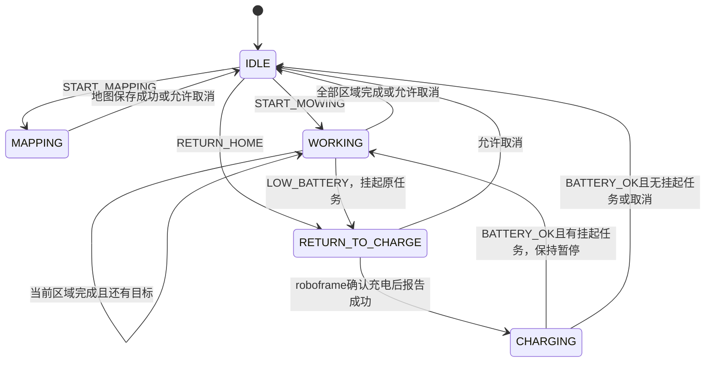
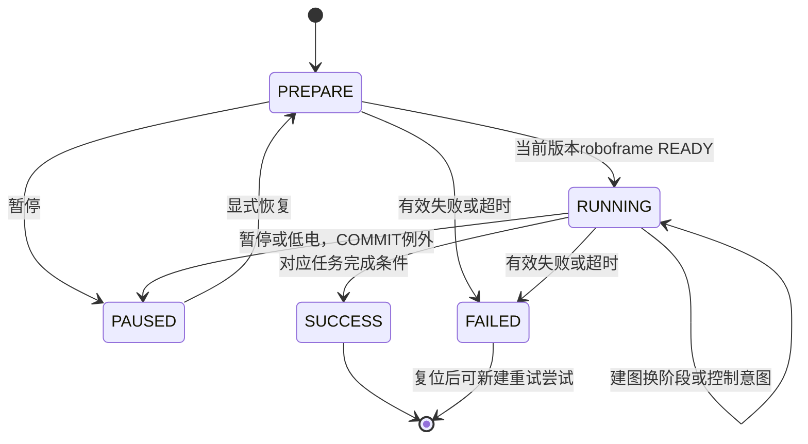
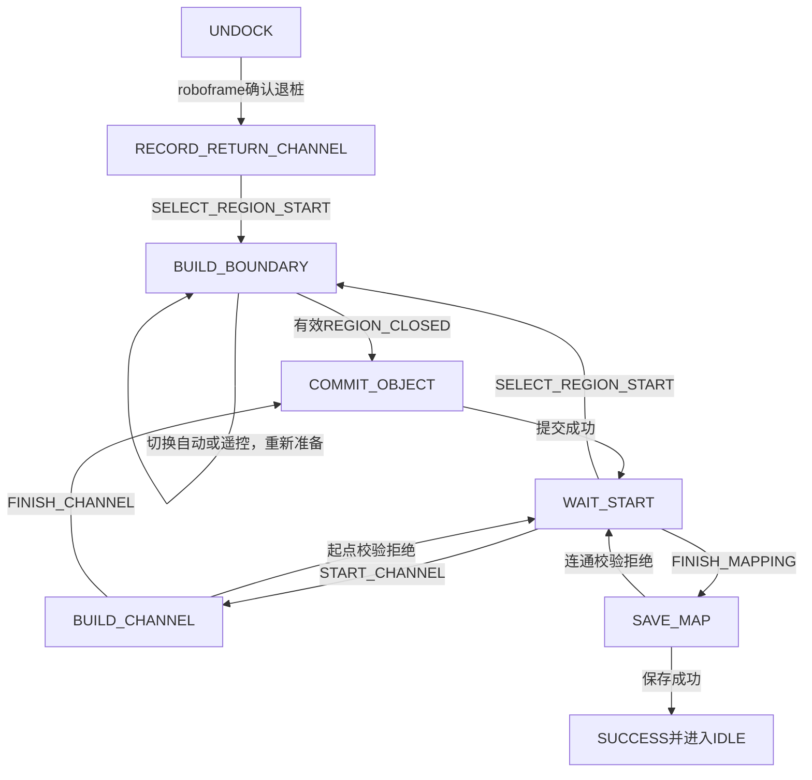

# Mode / Mission 状态机审查基线

2026-10-14，按单一 roboframe 原型更新。图描述本仓库代码，不表示真实算法或设备已接入。职责说明见 [DESIGN](DESIGN.md)，具体建图规则见 [MAPPING](MAPPING.md)。

## 业务 Mode

暂停和故障不覆盖业务 Mode。START 要求 IDLE、无活动/挂起任务、任务 ID 未用过；割草和建图要求无低电。主动 RETURN_HOME 仍只接受空闲发起，不顺带引入作业中主动回充策略。

低电在 IDLE、CHARGING、RETURN_TO_CHARGE 或故障锁存期间只更新事实。重复低电不替换挂起任务。BATTERY_OK 只有在 CHARGING 才恢复挂起上下文，其余时候只清低电事实。

## Mission 生命周期与任务身份

Mission 是一次区域割草、一次回充或整次建图会话。记录身份由 task_id、type、target_id、attempt 共同解释。区域完成后 attempt 从 1 开始；同 Task 的 task_id 不变。Brain 不存 EDGE/COVER 的运行阶段。

| 输入 | 行为与保障 |
| --- | --- |
| READY | 只在 PREPARE 生效；新 revision 执行 |
| PAUSE | PREPARE/RUNNING 且非 COMMIT；保留动作和业务模式，输出停止意图 |
| RESUME | 普通暂停同 attempt；已复位失败创建新 attempt；原 task_id 和目标不变 |
| FAILED/BLOCKED/通用 REJECTED | 保留恢复点，记录失败并锁存；健康恢复不自动解锁 |
| RESET_ERROR | 只清故障并设置 retry_pending；不恢复运行 |
| CANCEL | 允许时记录 cancelled 并清活动/挂起上下文；未决 COMMIT 拒绝，故障中先复位 |
| SUCCEEDED | 对应阶段才生效；整个区域完成才推进 cursor；整张地图保存才结束建图 |

输出优先级为故障、暂停、正常动作；RETURN_TO_CHARGE 映射 RETURNING。NONE 阶段无 mission/task_id，但 Brain 内部保留恢复上下文。停止意图不等于物理停车确认。失败的 COMMIT 重试直接保持 COMMIT；取消不伪造 SUCCESS/FAILED。

## 建图业务阶段

新动作先 PREPARE，当前 roboframe READY 后 EXECUTE；提交直接 COMMIT。闭合只在 MAP_REGION/EXECUTE 消费。提交成功须来自 COMMIT 的当前版本，之前的成功不可复用。START_EDGE_FOLLOW 与 TAKE_OVER 只在匹配的控制意图下接受，保持同对象采集草稿。通道必须从已有区域开始；至少一个区域提交后才允许最终保存。详细几何在替身，不在 Brain。

可恢复拒绝：通道 PREPARE 的 CHANNEL_START_OUTSIDE_REGION；SAVE_MAP/COMMIT 的 CHANNEL_NOT_CONNECTED、REGION_NOT_REACHABLE、RETURN_CHANNEL_REQUIRED、RETURN_CHANNEL_NOT_CONNECTED。它们保留会话，回 WAIT_START；其他错误走故障。

COMMIT 中低电先记事实，暂不切动作。对象提交成功记一次进度后暂停，最终 SAVE_MAP 成功可结束；业务校验拒绝也在回 WAIT_START 时暂停，不重新开放遥控。BATTERY_OK 后仍显式恢复。

## 算法执行边界与验收

| 业务 | Brain 可见阶段 | roboframe 内部职责 |
| --- | --- | --- |
| 区域割草 | MOW_REGION | 转场、沿边、覆盖、刀盘请求与确认、CoverageManager记录、剩余规划 |
| 多区域割草 | 当前区域成功后推进下一区域 | 只执行当前目标，不选择跨业务顺序 |
| 回充 | RETURN_AND_CHARGE | 导航接近、实时桩感知、Controller对桩、设备确认；无独立DockingComponent |
| 建图 | 上图用户业务阶段 | 定位、采集、闭合、几何校验和保存 |

原型仅接收 roboframe 一个状态来源；COMMIT 也只监控该来源。版本、时效、序号、去重、超时和快照隔离继续由 Health/Brain 保证。超时为 elapsed > timeout；新鲜的迟到消息不能消除已发生的超时。完整回放记录输入前后快照，不能拿未来帧解释当前转换。

验收入口：test_brain、test_health、test_mission、test_mapping、test_protocol、test_topology、test_runtime；回放语义由 test_report_state.cjs 检查。空间记录与设备事实检查是替身级验证，真实 BT、覆盖算法、Foundation 和 SSM 仍未接入；跨重启身份、提交结果查询和可靠持久化未实现。
