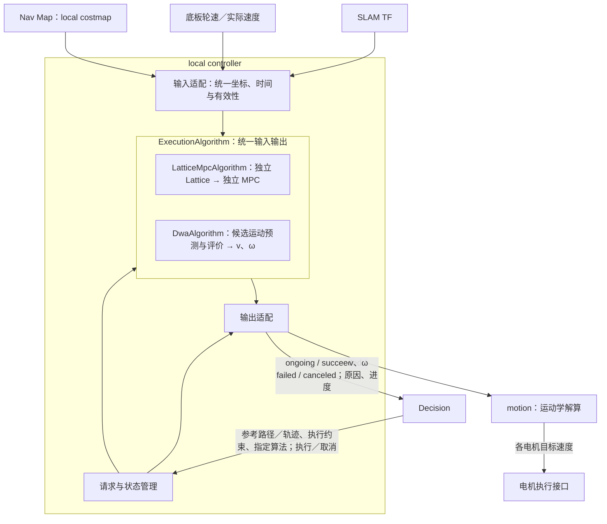

# local controller 模块设计

2026-11-05 确认职责方向，2026-11-14 统一名称为 local controller，职责不变。原架构图中的 Local planner 更名为 local controller；本文定义目标设计，不表示产品代码已调整。最新交互图见 [架构图](../sites/rlcp-architecture/dist/index.html)，点击 local controller 查看内部骨架与接口。

## 职责边界

| 模块 | 职责 |
| --- | --- |
| Decision | 下发参考路径／轨迹、执行约束与指定算法；决定重试、算法切换、恢复、回充及业务流程 |
| local controller | 执行当前请求，结合 TF、实际速度和 local costmap，持续输出 v、ω 与执行状态；不自行选择或切换算法 |
| motion | 仅做运动学解算，将 v、ω 转换为各电机目标速度 |

Global planner 将路径和规划结果交回 Decision，不直接与 local controller 交互。Nav Map 直接提供 local costmap；TF 来自 SLAM，底板轮速经输入适配形成实际速度，不能以命令值代替实测值。

## 内部骨架与数据流

两个算法实现是由请求指定的替代选项，不表示同时运行或串联。Lattice 生成局部轨迹，MPC 跟踪，两者保持独立，由 LatticeMpcAlgorithm 衔接。DWA 直接生成 v、ω，不再经过 MPC。

输入适配管理 TF 和地图，向算法提供本次计算所需变换与只读地图快照，不每周期复制整张地图。算法不维护 TF 缓存，不直接处理通信或业务消息。骨架统一请求生命周期、输入有效性、取消、到达与失败反馈；新增算法主要修改算法实现、配置和工厂，不修改主循环或通信逻辑。各算法可独立测试、迁移和替换。

## 统一约定与未决细节

以下规则需跨算法统一，具体协议与阈值仍待设计，不能由各实现自行解释：

- 参考路径与带时间轨迹的区别、坐标系和变换时刻、时间要求、允许偏离范围及执行约束。
- TF、实际速度和 costmap 的有效性、对时容差、缺失或过期处理；地图快照的生命周期、版本一致性和并发更新方式。
- 到达、失败与取消的判据、原因分类及进度口径。阻塞作为原因／执行信息，不额外替代四种执行状态。
- 请求替换、取消及迟到结果和旧速度指令的隔离；建议明确拒绝不支持的算法或无效请求，不静默切换算法。
- 同一时刻只有一个有效运动输出来源，包括 local controller 与 Recovery 的互斥。仲裁、命令时效和系统停止约束的落实位置待定，不因 motion 职责收窄而省略。
- 发送零速、取消完成与实际停稳是不同事实。恢复前若要求停稳，须取得有效设备证据；反馈链路与判据待定，不能由 canceled 推断停稳。

## 原 local_control 的职责归属

仅记录设计映射，不修改或重新核对实现：TrajectoryPlanner 的主循环、启停及执行状态归 local controller 骨架；定位、速度与地图接收归输入适配；速度发布及状态反馈归输出适配。Lattice、iLQR 等保持独立，由相应组合调用；MotionControl 的 MPC 调用与参考点选择归算法组合。工厂与配置统一创建 ExecutionAlgorithm，Frenet 专属判断保留在对应算法内。回充、重试及算法切换归 Decision。

当前 MotionControl 主要包含跟踪控制，不能直接等同下游仅做运动学解算的 motion。
