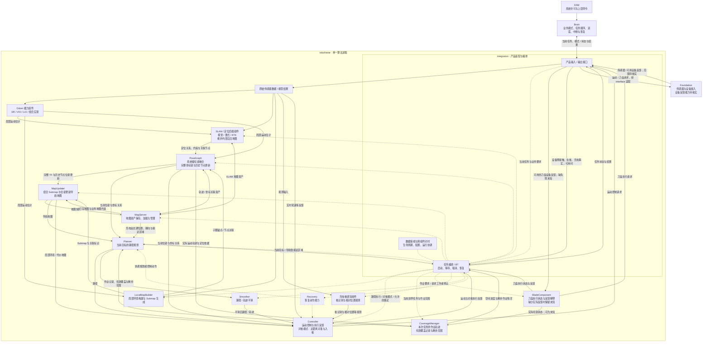

# roboframe 算法组件架构：当前讨论基线

日期：2026-10-12。状态：讨论基线，尚未定稿，不代表组件或接口已经实现。

本轮确认新增 CoverageManager、BladeComponent 和充电桩感知三项独立能力；对桩执行归 Controller 的对桩模式，不新增独立 DockingComponent。以下将已确认的职责方向与尚待核实的设备反馈、实现细节分开记录。

本文记录用户架构图及后续解释，并保存本轮整理的完整关系图与能力职责。当前只讨论架构，不确定算法内部实现、接口字段、TF 记号、队列长度或线程数量。本轮只更新 robotic-mower 文档，不修改代码。

系统职责以 [SYSTEM_DESIGN.md](../SYSTEM_DESIGN.md) 为准；本文是 roboframe 算法侧的当前讨论入口。[算法架构 V2](MOWER_ALGORITHM_ARCHITECTURE_V2.md) 保留为背景分析，其中未确认的建议不自动成为本基线的决策。

## 1. 已明确的架构方向

- Brain 已存在，业务职责基本维持：管理业务模式、任务顺序、进度、中断与恢复。
- 原先 perception、map_manager、pnc 三个算法进程合并到 roboframe 单一算法进程 `robot_runtime`；旧目录已在 Python 原型重构中撤去，有用数据模型迁入 simulation；不限定未来组件数量。
- roboframe 实际工作区为 WSL2 `Ubuntu-22.04` 中的 `/home/watermango/work/roboframe`，仓库为 [PU-UP/roboframe](https://github.com/PU-UP/roboframe)。本仓库尚未完成与它的实际接入。
- 沿用 roboframe 的 interface → integration → component 分层。integration 负责产品装配、接线、跨组件对时与编排；算法计算及融合归 component。组件之间通过公开数据与 integration 接线，不直接依赖彼此实现。
- Odom 表示必须具备的局部运动估计能力，可以由 DR、VIO、LIO 或组合实现提供；实际组件可以叫 `LIOComponent` 等，不要求统一命名或增加一层 Odom 包装。
- Controller 可以直接消费实时轮速等底盘反馈，这条输入不表示 Controller 重新做 DR。
- SLAM / 定位后端可以是一个或多个组件，输入 Odom 与图像、激光或 RTK 等数据，维护内部自洽地图。内部 map 不必与最终产品坐标系绑定；向外提供定位关系，以及闭环等约束和关联节点 ID。
- PoseGraph 的职责包括系统级位姿融合、高频输出、完整坐标关系和历史节点位姿更新。坐标链可按组件组合形成类似 base_link → odom → map → global 的关系；具体变换记号、方向和层数尚未确定。
- LocalMapBuilder 生成的 Submap 通过关联标识与历史节点位姿连接，MapUpdater 据此更新导航地图。历史数据需求可由 integration 串联 PoseGraph 与 MapUpdater 协调，具体保留策略尚未确定。
- CoverageManager 独立管理某次割草任务的历史作业轨迹、有效覆盖记录和剩余范围。Brain 继续管理业务任务、区域顺序、暂停、回充和恢复决策；内部 BT 协调当前任务执行，不接管长期作业记录。
- Planner 同时消费当前任务目标、定位、MapUpdater 的环境地图和 CoverageManager 的作业记录。覆盖历史不要求混入环境地图；已割区域仍可通行，不因已完成切割而成为障碍或禁区。
- BladeComponent 接收作业要求，负责刀盘执行状态与反馈解释；BT 决定何时请求工作或停止。它不预设自主调速算法，不重复硬件内部控制闭环。与 Foundation 的外部通信经 integration/interface 接线，设备反馈范围尚待核实；命令已发出不等于刀盘实际运转已确认，缺少实际反馈时保留未知状态。
- 充电桩感知组件提供桩识别与相对位置等观测，方法不固定。Planner 负责导航到接近区域，Controller 的对桩模式负责近距离对准与入桩，BT 协调导航、对桩、结果确认及允许范围内的重试。长期站点资产归地图管理；接触、在桩和充电事实来自设备侧。
- integration 继续负责装配、接线、对时和任务编排。BT 不成为长期地图、覆盖记录或设备状态的唯一所有者；本轮职责确认不表示这些能力已实现。

## 2. 完整架构图

实线表示数据与执行请求/反馈流，虚线表示任务与控制关系；Smoother、Recovery 的虚线边框表示可选能力。图中组件连线均由 integration 接线，不表示组件直接依赖其他组件实现。核心能力清单保留原有八项主体，并新增 CoverageManager、BladeComponent 和充电桩感知，不要求与类、仓库或线程一一对应。

图的阅读约定：

- IO 是 integration 的公开产品边界；外部传输适配由 interface 承担，不意味着传输实现移入 integration。
- 输入框汇总原始数据和模型结果，不要求每种数据流经同一个中心组件，也不要求模型推理适用于所有产品。
- BT 的虚线表示任务协调关系，不要求每个持续运行的组件都包装成 BT Action；反馈经 integration 汇集。本图显式补齐规划、控制、覆盖与刀盘反馈，其他返回线仍省略。BT 不拥有这些组件长期数据的唯一副本。
- Planner → Controller 与经过 Smoother 的路径是可选组合，不表示同时向 Controller 下发两条相互竞争的路径。
- MapServer 与各地图相关组件的连线表示资产保存和加载，不表示每帧数据经 MapServer 转发。充电桩长期位置、朝向等属于地图管理职责，图中由 MapServer 表达；实时桩观测由充电桩感知组件提供。CoverageManager 的作业记录独立于环境地图，其持久化机制暂不指定给 MapServer。
- Foundation 的反馈连线表示架构所需的来源，不声称设备已提供全部反馈。刀盘请求发出或被接收不构成实际运转证据；接触、在桩与充电也不能由地图位置或视觉对准代替。缺少证据时保持未知或未确认，不误报完成。
- 图中控制请求仍受系统许可与执行侧约束；SSM/foundation 的完整执行保护链不在本图展开，参见系统设计。
- 本轮确认覆盖管理、刀盘执行和桩感知的职责，以及 BT/Planner/Controller 的回充协作。MapServer 的完整资产范围、定位输出的具体消费方式、对桩阶段是否增加短路径规划等仍待定，图中的能力与连线不代表接口或实现已经完成。

## 3. 核心能力组件职责

| 能力组件 | 必备职责 | 主要交付 |
| --- | --- | --- |
| Odom | 提供局部连续运动估计，允许不同算法或组合实现 | 局部位姿、运动状态 |
| SLAM / 定位后端 | 利用 Odom 与视觉、激光、RTK 等输入，维护内部地图与定位关系，产生约束 | 定位结果、闭环等约束、节点关联、内部地图资产 |
| LocalMapBuilder | 将观测组织为局部环境与子图 | Submap、子图关联信息 |
| PoseGraph | 融合运动与定位信息，维护系统采用的坐标关系和轨迹 | 高频位姿、完整 TF、历史节点位姿更新 |
| MapUpdater | 根据子图及其位姿形成、更新导航所用环境地图；不要求承载覆盖历史 | 全局导航地图、局部环境或代价地图；已割状态不自动变成通行限制 |
| MapServer | 管理长期地图资产及其关联关系，承接充电站位置、朝向等地图管理职责 | 地图保存、加载、查询与版本管理，以及长期站点资产；完整资产范围待定 |
| CoverageManager | 独立管理某次割草任务的历史作业轨迹、有效覆盖记录和剩余范围；结合实际运动与刀盘状态记录，续割保留原任务的空间进度 | 向 Planner 提供作业记录与剩余范围，向 BT/Brain 提供空间进度；不接管业务任务、区域顺序、暂停、回充和恢复决策 |
| BladeComponent | 接收作业要求，跟踪就绪、运行、停止、失败或未知等执行状态并解释反馈；不预设自主调速，不重复硬件内部控制闭环 | 经 integration/interface 向 Foundation 发出执行请求；向 BT 提供执行反馈，向 CoverageManager 提供实际切割状态；缺少实际反馈时保持未知 |
| 充电桩感知组件 | 识别充电桩，提供相对位置等观测；二维码只是可能方案，不固定感知方法 | 向 Controller 的对桩模式提供实时观测；不管理长期站点地图，不凭视觉结果确认在桩或充电 |
| Planner | 同时消费环境地图、CoverageManager 的作业记录、定位和当前任务目标；根据剩余范围规划续割，回充时导航到接近区域 | 路径、规划状态与结果；对桩阶段是否需要额外短路径规划待定 |
| Controller | 根据路径、定位、环境和实时底盘反馈执行运动；对桩模式消费桩感知观测，完成近距离对准与入桩 | 运动控制请求、执行状态与对桩反馈；不以到达位置或完成视觉对准替代设备侧充电事实 |

SLAM / 定位后端可以由多个组件共同承担，不要求视觉、激光和 RTK 合为一个通用组件。LocalMapBuilder、PoseGraph、MapUpdater 分别侧重子图内容、子图及轨迹位姿、导航地图生成；内部算法和数据格式另行设计。

### 3.1 割草与续割的数据闭环

Brain 确定当前业务任务、区域顺序及暂停、回充、恢复决策；BT 将当前任务目标和作业范围交给相应能力，协调路径执行与刀盘工作。Planner 同时读取 MapUpdater 的环境地图、CoverageManager 的作业记录，以及定位和目标，生成路径交给 Controller。

实际运动轨迹与 BladeComponent 解释的切割状态进入 CoverageManager，形成该次任务的作业记录，再反馈给 Planner 和 BT。计划路径仅代表意图，单纯经过也不代表有效切割；刀盘实际状态未知时，不能将相应轨迹直接确认为有效覆盖。覆盖记录不必写进环境地图，已割区域仍可作为转场或衔接路径通行。

回充时保留原任务的空间进度；Brain 决定恢复后，Planner 根据剩余范围及当前环境重新规划，尽可能减少重复切割，而非要求沿旧路径机械继续。记录格式、持久化与跨重启恢复机制待定，本文不宣称已经具备这些实现。

### 3.2 刀盘执行与反馈闭环

BT 决定何时请求刀盘工作或停止，BladeComponent 接收作业要求，经 integration/interface 与 Foundation 交互，并根据可用设备反馈维护执行状态。该状态回到 BT 用于执行协调，同时提供给 CoverageManager 作为覆盖记账依据。组件名称统一为 BladeComponent，替代此前讨论中的 CuttingController 表述。

Foundation 可提供的刀盘设备反馈尚待核实。发出命令不等于刀盘已实际运转或停止；缺少对应实际反馈时保留未知状态。这里确认的是执行能力与状态解释职责，不预设自主调速算法，也不重复设备内部闭环。

### 3.3 回充与对桩的数据闭环

Brain 决定回充及目标站点；地图管理提供充电站长期位置、朝向等资产，Planner 规划到接近区域，Controller 执行导航。BT 根据规划和控制反馈协调进入对桩阶段；充电桩感知组件提供实时观测，Controller 在对桩模式下完成近距离对准与入桩，运动产生的新观测继续支持对准。

Controller 提供对桩执行反馈，设备侧经 integration/interface 提供可用的接触、在桩和充电事实。BT 结合这些事实协调结果确认及允许范围内的重试，再向 Brain 报告结果。地图位置或视觉对准不构成已经充电的证据；相应设备事实不可用时不能报告已确认充电。

本轮不新增独立 DockingComponent，也不固定二维码或其他桩感知方法。对桩阶段是否需要额外短路径规划尚未确定，未在图中强制增加这条规划链路。

## 4. 配套与可选能力

| 能力 | 架构位置与当前状态 |
| --- | --- |
| 输入适配、感知与模型推理 | 对应原图 raw & model；传输适配归 interface，感知算法可由组件承担，按传感器组合配置；是否独立及具体颗粒度待定 |
| integration | 产品装配、跨组件接线与对时、生命周期、配置、运行协调和任务编排；不承担位姿融合等算法计算 |
| 任务编排 / BT | 位于 integration，协调 Brain 下发的当前任务；决定刀盘工作/停止请求，协调导航、对桩、结果确认及允许范围内重试。长期地图、覆盖记录和设备状态归对应能力维护；具体任务划分和恢复策略仍待细化 |
| Smoother | 可选的路径 / 轨迹平滑能力；是否独立组件或由 Planner 内部实现待定 |
| Recovery | 可选的恢复动作能力；可以编排现有规划控制，也可能需要专门算法；是否独立组件待定 |

Brain 决定业务任务、区域顺序、暂停、回充和恢复，并保留任务层进度；CoverageManager 拥有某次任务的空间作业记录，内部 BT 协调当前任务执行。BT 不成为长期地图、覆盖记录或设备状态的唯一所有者，停树或重启执行不意味着清空这些能力的数据。这里明确的是职责方向，具体数据恢复机制仍待设计。

## 5. 组件运行属性：定性讨论基线

能力职责说明组件“负责什么”，运行属性说明它“何时计算、结果能等多久、依赖哪些历史、消耗哪些资源”。两种视图配合使用，不把组件简单分成第一、第二、第三优先级。数据依赖的先后顺序不等于调度优先级；模型推理是下游输入来源，并不因此必然比 Controller 更优先运行。

### 5.1 分类维度

| 维度 | 要回答的问题 | 对架构的帮助 |
| --- | --- | --- |
| 触发方式 | 按周期、随输入、按任务，还是后台持续处理？ | 明确谁驱动计算，避免所有组件套同一种运行方式 |
| 时效要求 | 结果允许多旧？一次处理允许等多久？过期怎么办？ | 确定不能被阻塞的链路，以及失效如何传递 |
| 历史依赖 | 只需要最新输入，还是必须连续积累？会不会修改过去的结果？ | 确定缓存、丢帧、重置及历史更新的边界 |
| 资源特征 | 计算小而稳定，还是耗时波动大？是否处理大地图或使用加速器？ | 判断执行资源的共享与隔离需求 |

处理频率与数据新鲜度分别描述：高频发布不表示获得了新的观测。具体频率、允许延迟、结果有效期、资源预算及调度优先级均待后续需求与测量确定。

### 5.2 运行属性表

以下是按当前架构形成的定性描述，不是已验证的性能结论或固定调度方案。PoseGraph、MapUpdater 按不同工作项分行，不要求因此拆分组件或线程。

| 能力或内部工作 | 触发方式 | 时效重点 | 历史与资源特征 |
| --- | --- | --- | --- |
| 模型推理 | 新图像或选定采样节奏 | 观测不能持续积压变旧 | 通常计算较重；是否依赖连续帧由模型决定 |
| Odom | 传感器输入驱动 | 连续、及时的运动估计 | 有递推状态，不能随意跳过必要的中间量测 |
| LocalMapBuilder | 对齐后的观测到达 | 及时反映局部环境 | 跨帧累积，维护局部地图或活动子图 |
| PoseGraph：当前位姿输出 | 高频运动输入或周期 | 稳定提供当前估计 | 持续维护状态，不能等待一次历史重优化完成 |
| PoseGraph：历史修正 | 新约束或优化结果到达 | 修正的一致性与完成时间 | 涉及历史节点，计算量可能波动 |
| SLAM / 定位后端 | 关键帧、匹配请求等，通常低于局部运动估计频率 | 在可接受时间内提供校正 | 保留历史关系，匹配与优化可能耗时较长 |
| MapUpdater：局部 costmap | 新观测、子图或位姿更新 | 局部环境足够新 | 更新范围与计算量需要有界 |
| MapUpdater：全局地图 | 子图完成、历史修正等 | 地图版本一致，更新可以较慢 | 数据量大，可能批量更新 |
| Planner | 目标变化、重规划条件触发 | 在任务允许时间内给出可用路径 | 单次任务计算，耗时随场景变化 |
| Controller | 固定控制周期 | 周期稳定，输入有效 | 工作状态连续，单周期计算应可预测 |
| MapServer | 保存、加载、查询请求 | 任务响应与资产完整性 | 大数据与存储操作，耗时可能波动 |

Smoother、Recovery 仍为可选能力；在用途与组件边界明确后补充运行属性，不提前规定统一频率。

### 5.3 对架构设计的作用

- **确定不能互相等待的工作。** 运动反馈／位姿 → Controller → 控制输出，以及观测 → 推理／LocalMapBuilder → 局部 costmap → 运动避障，是重点关注的及时处理链路。历史优化、全局地图重建和保存不能成为它们每轮运行的阻塞前提；地图尚不可用时应明确报告不可用，而不是强行继续。
- **区分拥塞时的数据处理语义。** 无跨帧状态的推理可能跳过尚未处理的旧图像；Odom 必需的连续量测不能照搬“只留最新一条”；历史约束与子图修正需要最终处理或可恢复的一致快照；目标已改变的规划请求可能需要取消。这些是后续设计依据，不是本轮已选择的队列策略。
- **区分组件存活与结果可用。** 当前位姿有效、历史优化未完成、全局地图版本较旧、局部 costmap 新鲜、模型结果过期，是不同事实，不能全部压成一个 RUNNING 状态。
- **指导后续测量与调度。** 先明确允许延迟、结果年龄、单次计算耗时及资源竞争，再确定优先级、线程、队列和执行资源隔离；不按组件名称或依赖顺序直接分配优先级。

Controller 持续运行表示控制执行链持续获得调度，处理反馈、停止与失效。有有效任务和许可时输出运动指令，其他状态按定义输出停止或保持行为，不表示持续执行旧路径。

## 6. 尚未确定的部分

以下条目记录设计空间，不要求在当前架构讨论阶段逐项回答，也不代表已经选择某种实现。

| 待定项 | 当前保留的边界 |
| --- | --- |
| 组件数量与实现组合 | 保留原有八项主体，新增 CoverageManager、BladeComponent 和充电桩感知三项独立能力；不新增 DockingComponent。能力不强制与仓库、类或线程一一对应，SLAM 与 Odom 均允许不同组合 |
| SLAM 与 PoseGraph 的估计分工 | 已明确 SLAM 可提供约束和节点 ID，PoseGraph 更新系统轨迹；二者内部优化范围、信息去重及融合方式待定，GTSAM 或滤波器仅为可能实现 |
| 回环与地图优化范围 | 与当前轨迹回环可关联历史节点；与已有地图匹配可约束当前节点。历史轨迹及已有地图是否参与调整尚未确定，不把“约束当前节点”写成“只能改变当前节点” |
| 坐标关系与最终位姿来源 | 内部 map 可独立于 global；具体 TF 表达、关系层数、Odom 与融合输出的消费方式待定 |
| Submap 内容与更新方式 | 已明确通过关联标识绑定历史位姿；子图几何是否冻结、是否重建及节点绑定方式待定 |
| 历史位姿需求与保留 | integration 串联 PoseGraph 与 MapUpdater 的需求；历史范围、更新形式、队列长度及优化器状态管理待定 |
| MapUpdater 输出组织 | 全局导航与局部环境均需满足消费者需求；是否分组件及各自更新策略待定 |
| CoverageManager 的记录与恢复 | 已确认独立维护某次任务的空间进度并支持按剩余范围续割；具体记录格式、有效覆盖判定细节、持久化及跨重启恢复机制待定，不要求覆盖历史进入环境地图 |
| BladeComponent 与设备反馈 | 已确认执行状态和反馈解释职责；Foundation 能提供哪些刀盘反馈尚待核实。实际运行或停止缺少证据时保持未知，不由命令发送成功推断；不预设自主调速或重复硬件闭环 |
| 桩感知与对桩规划 | 已确认实时桩感知组件与 Controller 对桩模式的分工；具体感知方法、对桩阶段是否需要额外短路径规划待定 |
| 对桩结果的设备证据 | 接触、在桩与充电事实应来自设备侧；可用反馈及其解释仍需核实，不凭地图位置、视觉对准或运动完成确认已经充电 |
| MapServer 资产范围 | 充电站长期位置、朝向等由地图管理维护，与实时桩感知区分。SLAM 资产、轨迹、导航图和业务地图的完整保存分工仍待定；业务区域、边界、通道、禁区等创建、编辑和校验能力必须保留，不顺带新增其他组件 |
| Brain 与内部 BT | Brain 保留业务任务、区域顺序、暂停、回充和恢复决策；BT 协调当前任务、刀盘请求、导航对桩和结果确认。具体任务粒度、允许重试的范围与恢复策略待细化，长期数据不由 BT 独占 |
| Smoother / Recovery | 作为可选能力保留，不预先要求独立实现 |
| SDK、产品接口与运行细节 | 类型、字段、频率、线程、队列和调度策略按真实组件需求设计；当前框架示例不作为算法能力已实现的证据 |

## 7. 与当前原型的关系

2026-10-14 已将 Python Brain 和仿真改为单一 roboframe 任务入口，撤去旧三个算法产品目录；Brain 每次下发整个区域割草目标，并在恢复时保留原任务标识。地图、观测和路径数据模型迁入 simulation，替身验证内存作业记录及刀盘/充电确认边界。实际组件、BT、Foundation 和生产接口均未接入；本图仍是目标能力基线，不应把替身当作组件实现。重构范围见 [计划记录](BRAIN_ROBOFRAME_REFACTOR.md)。

CoverageManager、BladeComponent、充电桩感知与 Controller 对桩模式均为目标组件职责，真实组件尚未实现。Python 替身已区分 Brain 的区域级进度与算法侧的任务空间记录，不再要求未完成区域全部重做；记录格式、持久化及真实剩余范围规划仍待设计。

实际接入、性能、地图一致性及运动闭环均未由本次原型重构验证。后续确定某项边界时更新本基线，明确其从“待定”变为“已确认”，再开展相应接口与实现设计。
