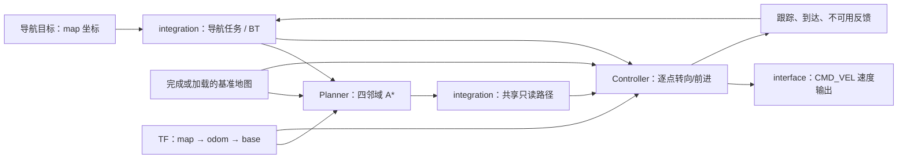

# roboframe 导航 demo：Planner、Controller、TF 与 BT

日期：2026-10-14。代码工作区为 WSL Ubuntu-22.04 的 `/home/watermango/work/roboframe`。
本文记录 2026-10-14 的历史验收，不代表 roboframe 当前主分支实现。当时的设计和协议位于该仓库 `docs/navigation-demo.md`，BT 职责说明位于 `docs/behavior-tree.md`。

2026-10-30 复核：当前工作区 HEAD 为 `21586e2`，上述两份文档及 `build-nav/` 已不存在。历史提交 `293b003` 保留了后续 2026-10-15 的导航版本，但其 Server 架构和测试数量已变化，不能代替本文验收版本。本文未记录原始验收提交号；以下代码结构、测试数量和命令均为当时记录，复现前需先找回对应源码版本。本地导航统计副本仍可读取，路径点、长度、速度事件数及取消/TF 停流归零结果与本文一致。

## 先纠正 BT 的归属

BT 是实现任务的编排机制，不是任务类型，也不是必须公开的业务契约。
之前放在 tasks 的树实现已移至 `products/demo_robot/orchestration/sequence.hpp`，
contract 中的树状态定义和 `mapping_tree_status()` 已移除。

| 位置 | 内容 |
|---|---|
| orchestration/ | 产品内部的 Sequence、Tick/Halt、节点执行状态 |
| tasks/ | 建图、导航等具体任务；可以使用 BT 实现执行过程 |
| contract/ | 任务目标、状态、路径上下文、速度输出；没有 BT 类型 |
| components/ | 算法能力；不依赖 BT、产品 contract 或其他组件 |

目前两项任务复用同一个简单 BT 机制：建图 `Collect → Drain → Freeze`；导航 `ComputePath → FollowPath`。

## 导航链路



职责划分参考 Nav2 的 [ComputePathToPose](https://docs.nav2.org/rolling/configuration_and_development/configuration_guide/core_servers/bt_plugins/actions/ComputePathToPose/) 与 [FollowPath 路径传递](https://docs.nav2.org/rolling/getting_started/nav2_behavior_trees/)。
这里用 typed 的不可变 Path2DPtr 传递，没有引入 ROS action 或字符串黑板。

- **Planner**：输入地图、TF 和目标，四邻域 A* 绕障；未知格阻塞，按 0.2 m 演示半径保守留余量。计算在独立有界执行通道中，可协作取消，不修改输入地图。
- **Controller**：持有共享路径，读取当前 TF 与基准地图，按约 20 Hz 计算 body 坐标的线速度/角速度；先转向再前进，限制 0.3 m/s、1 rad/s。
- **TF**：用 `T_map_base = T_map_odom × T_odom_base`，同时检查定位有效性和里程计接收新鲜度。500 ms 无新里程计，失败并发布零速度。
- **任务**：planning → following → succeeded / failed / canceled。只在真实输入位姿满足末端位置和朝向条件时成功；速度发布本身不能推进位姿。
- **取消/停止**：取消令牌使规划退出，session/generation 隔离迟到结果，Controller 清路径并发布零速度。runtime 停止时在等待工作线程前先发布零速度。

地图使用 FINISH/LOAD 产生的基准快照，不直接消费未完成的实时建图结果。缺少地图或有效 TF 时拒绝启动。
Controller 检查当前位置到下一路径点的空间；阻塞、地图几何变化或定位偏离路径时失败，不隐式重规划。
导航活动时拒绝同步地图写入与完整地图导出，避免现有磁盘操作阻塞控制 owner。

新增 SDK datatype 只有实际共享的 Path2D、Twist2D；SDK core 和原六组件不需要改动。
Planner、Controller 均能独立交付。新数据头尚未单独发布版本，使用本次源码需重建 SDK/组件包。

## 运行与验证

在 roboframe 根目录执行，两个输出目录须不存在：

```sh
cmake -S . -B build-nav -DROBOFRAME_PRODUCT=demo_robot -DCMAKE_BUILD_TYPE=Release
cmake --build build-nav -j4
ctest --test-dir build-nav --output-on-failure
python3 tools/mapping/replay.py --dataset corrected --scans 0 --finish-after 909 \
  --binary build-nav/robot_runtime --output build-nav/reference-map
python3 tools/navigation/demo.py --map build-nav/reference-map/live.rfgrid \
  --binary build-nav/robot_runtime --output build-nav/navigation-demo
```

stdio 新增 NAVIGATE、NAV_CANCEL、NAV_STATUS、GET_PATH，输出 NAV、PATH 和 CMD_VEL 事件；订阅后可观察速度。
原建图协议继续有效，导航任务与建图 session 分开管理。

已验证：

- 30 项常规测试通过，包含规划绕障、未知阻塞、控制坐标转换、到达、取消、定位停流、重启与 IPC 校验。
- 新增导航相关 6 项 UBSan 检查通过。
- 八组件独立构建/测试/安装、纯包/混合构建、公开契约隔离与 33 个安装头独立编译全部通过。
- 全量 13,631 帧建图回归通过，地图与上一版逐字节一致。
- 910 帧真实数据参考地图上的导航 demo 通过：468 个路径点，约 46.5 m；本次产生 25 条速度事件，取消与 TF 停流后均为零速度。

本地结果副本：[规划路径图](../simulation/output/roboframe-navigation/path.svg)、[统计与路径](../simulation/output/roboframe-navigation/summary.json)、[实际输出事件](../simulation/output/roboframe-navigation/navigation-events.jsonl)。
这些是忽略提交的生成产物，克隆本仓库不会带上它们；WSL 原始产物当时位于 `build-nav/navigation-demo/`，2026-10-30 复核时该目录已不存在。

## 验证边界

**速度没有设备或运动仿真消费者。** 地图来自 data，导航演示的 TF 为明确提供的静止测试输入；没有把 cmd_vel 积分成位姿。
因此静止且持续提供 TF 时保持 following，不能声称已经完成真实运动闭环。

暂未实现自动重规划、恢复、局部动态障碍、速度平滑、设备停止确认或 Brain 实际接入。
半径、速度、周期和 TF 门限均为演示值；真正接设备前仍需校准、执行许可、时限和停止确认验证。
