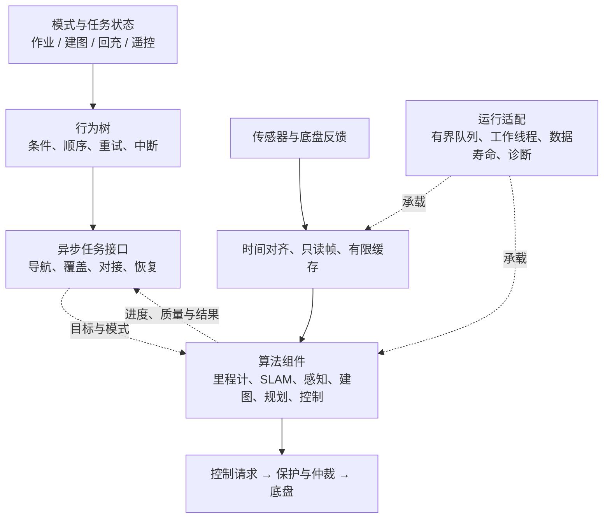

# 割草机器人算法、数据流与行为调度架构 V2（历史归档）

> 2026-10-14 归档：当前算法组件架构讨论入口为 [roboframe 架构讨论基线](../ROBOFRAME_ARCHITECTURE_BASELINE.md)。其中记录用户架构图、职责解释及待定部分；本文仅供背景追溯，不作为当前实施依据。

> 当前部署决策（2026-10-12）：原先 perception、map_manager、pnc 三个算法进程合并到 roboframe 的单一 `robot_runtime` 进程；Brain 的业务职责基本维持。本文算法、数据所有权与行为调度的划分仍用于讨论，§7.4、§10 中的多进程方案保留为历史备选，不是当前待选部署基线。具体组件和内部 BT 边界尚未定稿，Python 原型尚未接入 roboframe。工作区与仓库见 [项目说明](../../README.md#roboframe-工作区与集成边界)，当前系统职责以 [系统设计](../../SYSTEM_DESIGN.md) 为准。

设计日期：2026-09-29。适用约束：约 15 人；RTK + 单目/双目 + IMU + 编码器，或固态激光 + 单目 + IMU + 编码器；RK3562—RK3588 算力范围；差速或 4WD。设计未进行目标硬件性能验证。

本版替代以 Server 职责清单为核心的 V1。架构从可独立交付的算法、共享计算和数据所有权出发，再确定任务接口、线程和进程。使用团队熟悉的名称：里程计、SLAM、感知、局部建图、规划、控制、状态机、行为树。局部建图与地图融合是明确算法能力，不再新增 World Model 这一顶层名词。

## 1. 三种视图必须分别设计

| 视图 | 回答的问题 | 交付物 |
|---|---|---|
| 算法视图 | 每个人负责哪个子算法，其数学与数据依赖是什么？ | 输入输出、内部状态、有效条件、独立回放用例 |
| 行为视图 | 当前执行哪个任务，何时中断、重试、恢复？ | 模式状态机、行为树、异步动作与取消协议 |
| 运行视图 | 数据存在哪里，谁读写，计算在哪个线程/设备发生？ | 数据所有权、计算依赖、队列、缓存、进程部署、性能预算 |

三者可以映射，但不一一对应。一个导航 Action 可以组合多个算法；一个进程可以承载不同人员维护的多个算法；同一算法可以在离线回放、单元验证和车端运行中复用。

算法内部首先做普通库组件，外围只有薄适配层负责输入组装、线程、消息和记录。组件直接接收明确类型的输入，不依赖全局万能数据中心，也不在内部查找任意 Topic 或行为树黑板。



行为树不处理每帧点云，不决定 IMU 每个采样何时积分；运行调度不决定机器人先割哪个区域。这两种调度必须区分。

## 2. 可以分配给算法工程师的工作单元

下表是可独立实现与回放的算法单元清单，不是必须创建的 ROS 节点或人员数量。一个人可以负责几个单元，复杂单元也可以在内部多人协作。

| 算法单元 | 输入 | 输出 | 自己拥有的状态 | 主要验收点 |
|---|---|---|---|---|
| DR / 运动传播 | IMU、轮速、标定、上次状态；可选显式校正输入 | 运动增量、预测轨迹及质量 | 积分状态、偏置或其接口 | 连续性、时间误差、打滑退化、重置 |
| VIO | 有效图像/图像对、完整时间区间的 IMU、标定 | 位姿/运动估计、质量，必要的轨迹片段 | 特征轨迹、滑窗、偏置 | 延迟、漂移、初始化、跟踪丢失 |
| 激光配准前端 | 点云、运动初值/轨迹、只读目标子图 | 相对运动或配准约束、匹配质量 | 必要的匹配缓存 | 退化、初值敏感性、配准耗时 |
| 激光 SLAM 后端 | 激光约束、选定的运动先验、关键帧、可选全局约束 | 优化位姿、子图关系、重定位结果 | 位姿图/滑窗与地图索引 | 回环正确性、重定位、地图一致性 |
| 双目深度 | 已标定图像对、相应参数 | 深度/视差、有效掩码与质量 | 模型/工作区 | 草地低纹理、无效深度、延迟 |
| 语义识别 | 指定格式图像 | 语义/实例结果、置信度 | 模型/工作区 | 识别质量、置信校准、运行预算 |
| 地面与障碍提取 | 点云或深度、重力方向/姿态、可选语义 | 障碍、地面、自由空间和未知区域观测 | 有限的拟合/跟踪状态 | 坡地、低矮障碍、无回波与遮挡 |
| 局部地图融合 | 环境观测、对应时间的轨迹、上一地图 | 有时间与版本的局部占用/地形图 | 有限局部栅格/体素和证据历史 | 噪声、清除、运动配准、过期 |
| 覆盖规划 | 区域、幅宽、运动约束、待作业区域 | 条带、连接、顺序、剩余区域 | 可选计划缓存 | 覆盖率、转弯可行性、重复率 |
| 转场/局部路径规划 | 起终点或作业段、地图视图、运动约束 | 可执行路径与失败原因 | 搜索图/候选、有限缓存 | 路径有效性、取消延迟、耗时 |
| 路径处理 | 路径、定位关系、当前位姿 | 裁剪/平滑后的短期执行路径 | 当前路径进度 | 坐标一致性、方向、曲率 |
| 跟踪控制 | 短期路径、当前状态、局部障碍/约束 | 速度请求、跟踪误差和进度 | 控制器状态 | 稳定性、限速反馈、超时 |

地图文件管理、任务持久化、设备驱动、动作协议和运行适配不混入这些算法内部。它们由平台/集成人员提供，并使用同一套离线运行入口组装组件。

## 3. SLAM 的具体分工与数据流

### 3.1 松耦合方案：里程计与激光 SLAM 可以通过明确接口协作

```text
IMU + 编码器 ──→ DR / 运动传播 ───────────┐
图像 + IMU ────→ VIO（按配置启用） ──────┤
                                       ↓
                            选定的运动估计与轨迹历史
                                       ↓
雷达原始点云 → 时间/格式规范 → 运动补偿 → 激光配准 → SLAM 后端
                                       └────→ 障碍提取 → 局部地图融合
```

DR 与 VIO 是可选来源，不默认将所有结果再次独立融合。选源或融合的规则由估计链路负责人制定；组件开发者只实现约定接口。

里程计工程师交付运动估计、时间区间查询、质量和重置行为。激光工程师消费初值/轨迹，维护激光配准和地图相关状态。不要求里程计工程师理解回充和覆盖，也不要求激光工程师实现每个上游传感器驱动。

接口不能只有一个 pose。扫描补偿需要扫描区间内的运动；激光配准可能只需要起止运动初值。根据实际用途提供：参考坐标、起止时间、相对位姿或轨迹采样、质量、重置代号、是否为预测/校正结果。协方差的参考坐标和误差定义也要说明，未知时不得填零假装精确。

VIO 输出可能延迟或修正历史。适配层明确哪些结果供实时预测，哪些用于后台校正；不能默认所有名为 odometry 的结果都严格连续且不可修订。

### 3.2 紧耦合方案：拆子算法，但保留共享估计问题

若激光、IMU 和视觉共同优化状态、偏置和残差，纯 pose 接口可能损失关键相关性与联合估计能力。此时推荐在同一估计器内部按以下单元分工：

- 运动传播/预积分及其雅可比、噪声模型。
- 视觉跟踪与视觉残差。
- 激光匹配与激光残差。
- 状态管理、更新/优化和边缘化。

上述输入输出仍可独立测试，但状态定义、线性化点、偏置更新和误差约定需由估计链路负责人统一。不能要求每人产出一个黑盒 pose，再假设拼起来等价于紧耦合系统。

来自同一 IMU/轮速的信息若已经包含在 VIO/LIO 结果中，不再作为独立证据无条件重复加入。来源和使用方式在架构层确定。

### 3.3 去畸变共享的条件

相同原始帧、标定、运动轨迹版本和参考时刻下的补偿结果可以复用。共享输出保留完成标记及这些依赖，不重复执行。

如果 LIO 在内部迭代更新运动轨迹，其内部补偿结果可能与感知使用的低延迟预测版本不同。此时优先共享原始只读数据、轨迹插值和补偿实现，分别产出确有必要的结果；不能强行统一成唯一补偿云而改变算法含义。

同理，激光定位用稀疏特征，感知用较完整几何。共享源帧和可复用中间结果；索引、掩码和所需分辨率不同的输出保留独立身份。

## 4. 感知与规控也按计算依赖组织

图像链路建议：

```text
相机图像帧
  ├─→ VIO 需要的灰度/金字塔 → 特征跟踪
  ├─→ 双目校正 → 深度 + 有效掩码
  └─→ 网络所需缩放/颜色布局 → 语义识别
                    深度/点云 + 语义 + 对应时刻姿态
                                 ↓
                        地面/障碍/自由空间提取
                                 ↓
                            局部地图融合
```

可共同使用的灰度、缩放、校正或模型骨干结果只计算一次，但前提是尺寸、颜色空间、相机模型、精度和延迟需求一致。VIO 未必需要双目深度，也未必接受语义网络那份缩放图像。不要为了“统一预处理”先把所有图像转成大 RGB 图、再让每个算法转回灰度或张量。

感知工程师分别负责深度、语义、几何提取；融合工程师负责观测配准与时间证据。没有度量深度的单目配置如实输出自身能力，不伪造度量占用信息。

规控链路建议：

```text
区域/剩余作业范围 → 覆盖规划 → 作业段
全局地图 + 目标 ──────────────→ 转场/连接规划
局部占用图 + 作业段 ──────────→ 局部绕行/路径修复
                                      ↓
                         路径处理 → 跟踪控制 → 运动请求
```

局部占用融合只由一个组件维护；规划和控制获取同一发布版本的只读视图。它们可以拥有自己的搜索缓存、轨迹候选和软代价，不再各自积累一套障碍历史。

车体几何、碰撞计算、地图查询和坐标工具作为小型共享库本地调用。不同算法重复做一次廉价碰撞复核是合理的；不能把它们都改成跨进程查询来追求形式上的统一。

## 5. 行为树、Behaviour 与状态机各自做什么

| 层次 | 负责 | 不承担 |
|---|---|---|
| 模式/任务状态机 | 当前允许建图、作业、回充还是遥控；持久任务状态；模式切换 | 每帧数据调度和每个恢复分支细节 |
| 行为树 BT | 作业步骤、条件检查、重试、失败恢复、暂停和抢占 | 点云处理、滤波、优化迭代和高频控制 |
| Behaviour / Action | 一个有开始、进度、结果和取消语义的行为，如导航、倒退、对接 | 替每个底层算法重新建一份数据缓存 |
| 算法运行适配 | 组装输入、调用算法、调度工作、发布结果和反馈 | 决定业务优先级 |

任务状态机保存持久业务状态；BT 保存当前流程执行状态。两者不维护相互竞争的“当前作业状态”：任务管理是业务状态权威，BT 的执行结果更新它。

一个作业流程可表达为：检查准入 → 请求覆盖计划 → 导航到作业段 → 执行作业 → 更新实际覆盖 → 选择下一段。遇障恢复、回充和重定位分别是子树或可取消的 Behaviour。这里是语义流程示意，不是可直接运行的 BT XML。

行为树黑板保存 task_id、区域 ID、目标、plan_id、状态摘要及小型路径引用；不保存点云、相机帧和不断增长的轨迹历史。即使只保存句柄，也要避免让黑板长期占住大缓冲。

长任务通过非阻塞的开始、查询反馈、取消接口连接。BT tick 只触发/检查；规划、对接和控制在自己的执行上下文工作。BehaviorTree.CPP 官方也强调阻塞 tick 会阻塞树的执行。[异步 Action 说明](https://behaviortree.dev/docs/guides/asynchronous_nodes/)

取消分三步：请求取消 → 撤销或更新执行权限 → 确认终止/停车。旧规划结果根据 task_id 和执行代号丢弃。低电量可以触发 BT 抢占；紧急保护独立于 BT 的 tick 时序。

## 6. 数据如何共享、修改和释放

这是运行架构的核心。每一种大数据都要回答：谁分配、谁写入、谁读取、何时释放、积压时怎么办。算法包的目录名不能回答这些问题。

### 6.1 每类数据的具体规则

| 数据 | 写入者与发布形式 | 消费方式 | 有界与释放规则 |
|---|---|---|---|
| 原始图像、原始点云 | 驱动/输入适配层写完后发布只读帧 | 同进程消费者持有带所有权的只读视图 | 缓冲池有容量上限；所有读取者及设备访问完成后才可归还 |
| 校正图、深度图、去畸变点云 | 对应预处理组件生成独立输出 | 满足相同处理条件的消费者复用该结果 | 按输入帧及处理版本关联；不做无限历史缓存 |
| 运动轨迹历史 | 选定的运动估计链路维护 | 按观测时间区间查询或取得稳定区间快照 | 保留时长覆盖允许的延迟；超出窗口返回失败，不能拿最新 pose 顶替 |
| 局部占用图 | 局部融合组件唯一写入 | 规划和控制读取一致版本的快照 | 读者不能长时间占住版本；旧版本达到容量预算时有明确拒绝/降频策略 |
| 全局地图与子图 | SLAM/地图维护组件按地图类型拥有 | 按区域、子图、分辨率获取；后台保存 | 不在每次优化后广播整份稠密地图；发布更新或新版本索引 |
| 路径与轨迹 | 规划/路径处理组件生成 | 执行器持有当前有效版本 | 带任务和版本；切换有明确生效时点，旧结果不能覆盖新任务 |
| 特征、索引、掩码和候选轨迹 | 对应算法拥有 | 只有真实跨算法需求才公开 | 私有临时量留在算法内部，允许复用工作区 |

只读视图必须携带或间接保持缓冲所有权。仅传裸指针、引用或图像头，不能保证异步任务使用时数据仍然存在。生产者发布后也不能通过另一个可写引用悄悄修改缓冲。

小型元数据可以按值复制；追求共享的是昂贵的大载荷，不必为几十字节的状态建立复杂引用管理。跨进程传递普通指针无效。

建议为帧约定 source_id、frame_id、采集时间/时间区间、时钟域、标定版本、数据格式、步长、所在内存类型和所有权。时间戳指采集时刻，排队时刻和处理完成时刻另记。具体接口只携带自身需要的字段，不要求所有算法接受一个包罗万象的消息。

### 6.2 一条点云链路的拷贝预算

```text
驱动原始帧：缓冲 A，写完冻结
  ↓ 统一解码/格式归一（驱动输出已合适时可省略）
标准点云：缓冲 B，只读共享
  ↓ 用明确版本的运动轨迹去畸变
校正点云：缓冲 C，只读共享
  ├─ 激光匹配：私有特征/降采样结果
  ├─ 地面和障碍提取：私有索引、掩码或紧凑点集
  └─ 选中的关键帧：进入有界的后台地图处理
```

这里生成 B、C 是有计算含义的格式转换和几何变换。要消除的是 C 在几个消费者之间被重复整帧复制，以及不同组件用相同输入和参数重复生成 C。

是否使用索引视图要实测：索引可以减少复制，但随机访问可能损害缓存局部性；为后续多轮计算生成紧凑数组，有时整体更快。最终比较端到端耗时和内存峰值。

复用结果至少要求输入帧、标定、处理参数、运动轨迹版本和参考时刻一致。不同运动估计版本生成的两份去畸变结果不能因为原始帧相同就混用。

### 6.3 共享计算由显式依赖形成

例如双目校正由一个预处理组件生成，深度算法和需要相同校正图的视觉算法共同读取。若 VIO 使用不同分辨率、畸变模型或原始鱼眼特征，则它拥有不同的预处理分支。用产品配置连接这些依赖即可，首版不建设通用的全局计算缓存或自动去重引擎。

避免“统一入口强制转换成 RGB，VIO 再转灰度，模型再转另一布局”。尽量保留传感器原生布局，在真正需要转换的分支生成输出；相同分支共用输出。

量级示例：假设双目均为 1280×720、RGB8、30 帧/秒，一对图像约 5.53 MB。每增加一次整对复制，约搬运 166 MB/s 的有效载荷；按一次读取和一次写入计算，名义读写量约 332 MB/s。这是格式假设下的算术估算，不是目标板的实测带宽，也不代表复制一定是最大瓶颈。

### 6.4 慢消费者不能拖住实时缓冲

引用计数能防止提前释放，也可能让慢消费者占满池。后台优化、录制和可视化使用各自有界的输入策略：选择关键帧、只保留摘要、允许丢弃非必需帧，或复制到容量受限的后台缓冲。

为隔离实时链路而进行一次受控复制是合理选择。关键是把成本和上限记清楚。日志丢帧要可观测；估计器的必需测量不能静默丢失。

取消异步任务只表示结果可能不再被接受。CPU 工作、NPU/GPU 或其他设备访问尚未结束时，仍不能回收它正在使用的缓冲；释放必须等待实际完成信号。

### 6.5 地图快照先采用能验证的简单方案

局部融合在自己的工作区更新，发布完整且一致的只读版本。对于尺寸有限的局部栅格，按发布频率做一次受控快照复制通常比复杂并发机制更容易验证；其成本应先测量。确认成本过高后，再引入分块更新或写时复制。

双缓冲或三缓冲只有在复用前确认所有读者已释放时才成立。读者可能跨多个周期占用快照，不能靠轮换下标保证安全。也不要让规划持锁搜索，使融合和控制等待一整轮规划。

定位纠正时分开处理连续的 odom 轨迹和全局 map 对齐。局部图若以 odom 表达，可避免因一般的全局对齐变化而整体跳动；定位链路重置或局部轨迹被修订时，仍要根据版本清空、重建或重投影，不能假设永远连续。地图、路径和位姿的坐标及版本必须可检查。

## 7. 调度、线程和部署如何承接算法

### 7.1 算法接口之外，有一层薄的运行适配

算法本体接收明确输入，维护声明过的内部状态，返回结果和状态。输入组装、时间匹配、排队、ROS 消息转换及日志放在运行适配层。避免让算法内部到处订阅消息，或随意从全局数据中心取“最新结果”。

适配层也必须由明确的集成人员维护。它不能凭空消除算法的时序约束；算法作者需要声明所需时间区间、允许延迟、是否可跳帧、线程安全和状态重置条件。

一个里程计组件的交付卡至少包括：

| 项目 | 要明确的内容 |
|---|---|
| 输入 | IMU/轮速或图像观测、标定、观测时间范围；允许哪些输入缺失 |
| 输出 | 指定坐标系下的状态或相对运动、对应时间、协方差定义、有效性 |
| 历史 | 能否查询区间轨迹；延迟优化是否修订历史；修订版本如何表示 |
| 状态 | 初始化、正常、降级、失效、重置；异常原因和 reset_id |
| 并发 | 哪些调用必须串行；异步输出如何排序；取消后如何结束访问 |
| 内存 | 输入借用到何时；输出谁拥有；最大历史长度和工作区预算 |
| 时序 | 目标输入频率、允许延迟、最坏积压处置；超时输出如何标记 |
| 验证 | 离线数据、指标、异常样例及同一入口的回放方式 |

算法工程师应能用这张卡和一段录制输入独立运行自己的组件。需要理解的是输入保证和输出责任，无需了解整棵作业行为树或整台机器人所有节点。

### 7.2 队列按算法语义设计

| 链路 | 建议策略 |
|---|---|
| IMU/轮速 | 有界时间环形缓冲；收集所需区间，检测乱序、缺口和时钟异常；缺失时明确降级或重置 |
| 视觉里程计 | 按声明的序列处理；过载可丢帧的范围由算法约束决定；不能任意套用“只取最新帧” |
| 障碍感知 | 优先保证新鲜度，可跳过尚未开始的过期帧；结果保留原观测时间 |
| 激光匹配 | 保证扫描与运动区间一致；超出等待期限则采用明确的降级策略或放弃该帧 |
| 后端优化 | 关键帧/约束驱动，预算内运行；结果异步提交，并检查版本与当前状态是否兼容 |
| 控制 | 使用当前有效状态和轨迹；不等待后台优化完成；输入超龄触发限速/停车策略 |

各组件按依赖就绪运行；控制按自身周期运行；行为树按任务反馈和 tick 推进。不要让所有算法等待一份“所有传感器同一时刻齐全”的大消息。

状态估计存在反馈时，必须画出因果关系。例如当前扫描去畸变可以使用此前状态传播出的预测轨迹，再接受扫描匹配纠正；不能要求先拿到同一扫描优化后的轨迹才能开始该扫描优化。

### 7.3 线程与资源预算

首版采用固定的数据链路、少量有界工作队列和清晰的串行状态所有权。无需开发通用 DAG 执行引擎。算法回调收到输入后只做必要校验和任务投递；长时间计算放在受控工作线程，或在明确预算的专用执行上下文中完成。

运行时限制并行任务数，同时检查算法库自身的线程数，避免多个组件各自启用全核线程。NPU 推理并发、输入转换、设备同步和工作区容量由适配层统一管理；是否能直接导入相机缓冲，要依据具体驱动、SDK、格式及同步能力验证。

高频状态估计、控制和保护链路有独立的执行预算。后台建图、保存及调试流量不能无限增长。线程优先级的效果需要结合操作系统、锁和驱动测量；配置了优先级不代表获得了硬实时保证。

### 7.4 进程边界沿高成本数据链路选择

当前产品已选择 roboframe 单算法进程，承载原 perception、map_manager、pnc 的职责。以下进程拆分讨论仅在未来有测量结果和新部署需求时重新评估，不改变本次决策。

部署起点可以是：高带宽的相机/点云处理及相关估计、融合组件尽量同进程组合；任务管理和 BT 通过小型状态及 Action 接口连接；控制与底盘执行根据故障隔离和时延需求部署。全局优化是否独立出去，用峰值资源和故障影响决定。

这不是固定的三进程方案。需要先画出每条跨进程边的载荷大小、频率及允许延迟，再决定切在哪里。控制若必须独立进程，传递容量受限的状态、轨迹和所需局部地图快照可以是合理代价。

ROS 2 组件组合和进程内通信可以帮助共享载荷，但必须匹配所用消息、回调与发布方式。例如只读消费者可以采用支持共享所有权的消息方式；仅收到 const 引用的回调，不能在回调结束后直接保留该引用。实际行为以选定发行版和配置验证。[ROS 2 进程内通信文档](https://github.com/ros2/ros2_documentation/blob/rolling/source/ROS-Framework/nodes/Working-with-nodes/intra-process/Intra-Process-Communication.rst)

跨进程共享内存、借用消息以及设备缓冲导入分别解决不同环节的问题。中间件、消息类型和版本的支持条件不同；不能据此承诺整条相机到算法链路零拷贝。[ROS 2 借用消息配置文档](https://github.com/ros2/ros2_documentation/blob/rolling/source/ROS-Framework/client-libraries/Working-with-Client-Libraries/Configure-ZeroCopy-loaned-messages.rst)

### 7.5 两种产品复用接口和实现

RTK + 视觉方案配置对应的运动估计、全局定位和视觉感知链路；无 RTK 的激光方案配置激光定位/建图及相应视觉辅助。输入适配、轨迹查询、占用观测、地图读取、路径和任务接口保持明确；无法提供的能力明确标记。

低算力配置优先减少并行算法、图像尺寸、处理频率和后台预算，在目标场景验证性能与质量。不能默认 RK3562 能运行 RK3588 的全部链路。不同产品采用静态配置连接必需组件，首版不必建设动态算法市场或复杂热插拔机制。

差速与四驱共用上层速度/轨迹语义；轮速映射、运动约束、打滑特性和执行反馈由底盘模型及适配层声明。四驱是否采用滑移转向，必须依据实际机械形式确定。

## 8. 15 人团队怎样落地

人员可以继续按专业背景交流，交付和验收按组件接口及完整场景进行。以下是工作包容量示例，可随产品主线调整，不要求重组行政部门：

| 工作包 | 建议人数 | 主要交付 |
|---|---:|---|
| 总体架构与系统集成负责人 | 1 | 接口决策、性能预算、跨组件故障责任和整机验收 |
| 运动估计与 SLAM | 3 | DR/VIO、激光前后端及估计链路集成；按选定算法松紧耦合程度分工 |
| 感知 | 3 | 深度/视觉几何、语义、地面与障碍观测 |
| 地图融合 | 1 | 局部观测融合、地图版本与只读快照；与 SLAM 地图维护者明确不同地图的所有权 |
| 规划控制 | 3 | 覆盖规划、转场/局部规划、路径跟踪与底盘约束 |
| 任务与行为 | 1 | 模式状态机、BT、恢复/回充任务及取消语义 |
| 运行与产品适配 | 2 | 时间同步、数据缓冲、运行适配、资源预算、不同传感器与主控配置 |
| 回放与性能验证 | 1 | 共享数据集、故障注入、跨链路时延和内存分析 |

各算法作者仍负责自己的验证；最后一个工作包提供共用工具和整链路证据。15 人同时开发两套完整产品链路仍有明显容量压力，应先选一条主线完成闭环，第二套复用接口与运行机制逐步接入。

先做四份小而具体的工程资产：

1. **算法交付卡**：每个组件一页，使用第 7.1 节模板；先写 DR/VIO、激光匹配、障碍提取、局部融合和控制。
2. **共享计算表**：列出校正、去畸变、轨迹插值、降采样和栅格融合，记录输入/参数、唯一生成者、消费者及允许存在的变体。
3. **缓冲与排队图**：每个大数据边记录字节数、频率、所有权、容量、复制次数和超载策略；没有上限的队列不能通过设计评审。
4. **行为及异常时序图**：覆盖正常作业、定位异常、地图重置、绕障、暂停、回充和任务取消，标明谁发起、谁执行、谁确认。

第一条集成闭环选择“运动估计 + 障碍观测 + 局部融合 + 跟踪控制 + 一个可取消的导航任务”。用真实输入回放和台架执行验证接口、生命周期与性能，再扩展完整覆盖规划和恢复策略。这是建议的实施顺序，本文没有执行样机验证。

## 9. 验收架构是否真正解决问题

采用固定输入数据、产品配置及日志配置比较，保留观测采集到动作输出的时间链。至少测量 CPU/加速器耗时、排队时间、结果年龄、分配次数、整帧复制字节数、峰值内存、丢帧及截止期违约；看分位数和最坏样例，不能只看平均帧率。

| 验证情形 | 应得到的证据 |
|---|---|
| VIO、深度和语义并行读取图像 | 原始帧共享；语义相同的预处理只执行一次；不同预处理可解释 |
| 规划或日志人为变慢 | 主链路积压有界；输入新鲜度与丢帧可观测；无缓冲池永久耗尽 |
| 规划持有旧地图跨多个融合周期 | 快照不被覆盖，无数据竞争；版本积压按策略处理 |
| IMU 缺包或扫描超出轨迹窗口 | 不使用错误时间的 pose，输出明确无效/降级状态 |
| 全局纠正或估计器重置 | 坐标与版本检查有效；旧地图/路径按规则处理；不继续盲目执行 |
| 取消规划、推理或回充行为 | 旧结果不能驱动新任务，异步缓冲不会提前回收，停车确认独立可查 |
| 开启录制、可视化或跨进程订阅 | 记录新增序列化和复制成本，满足声明的调试配置预算 |
| 目标板连续运行与热稳态 | 后台优化、热降频和内存压力下的性能有实测数据，必要时收缩配置 |

最终设计评审应能回答四个问题：一个算法工程师能否凭接口和回放独立交付；一份大数据从采集到释放是否可追踪；每项高成本计算是否有明确的复用条件；行为取消和资源过载时机器人是否有确定的处置。模块数量和名称只是帮助表达这些答案。

## 10. 产品进程划分与共享内存的决策补充

### 10.1 同进程组合是正式部署方案

多个算法组件放在一个进程中，可以保持独立源码、接口、测试与负责人。满足所有权、回调和配置条件时，ROS 2 进程内通信可以让多个只读消费者共享同一消息载荷。同进程不代表单线程，独立线程/执行器也不代表拥有独立的崩溃恢复边界。

单一算法进程适合高带宽强依赖链路、整体重启可以接受、内存和运行时间有界的产品。若其发生故障，外部执行保护必须根据指令或状态超时进入预定停止状态。保护覆盖哪些故障，应按实际底盘、MCU 与驱动设计验证；另起一个 Linux 进程无法覆盖整机死机。

多个进程主要提供地址空间及重启边界。它们依然竞争 CPU、内存带宽、设备和内核资源，需要线程、资源与队列预算。共享的可写缓冲仍可能传播错误；进程分开不等于数据与故障完全隔离。

### 10.2 按数据边和恢复条件决定切点

| 候选边界 | 保持同进程的理由 | 分开的成立条件 |
|---|---|---|
| 原始帧、预处理、VIO/LIO、几何感知 | 数据大、频率高、复用多 | 驱动/推理 SDK 需要独立恢复，或资源/依赖冲突明显，且大数据通路已验证 |
| 局部融合、局部规划 | 反复查询同一地图；可共享只读快照 | 能以有界快照/分块传输承受成本，并获得有意义的恢复隔离 |
| 前端与 SLAM 后端 | 共享子图/状态，可能存在紧耦合 | 后端可消费稳定关键帧与约束、异步返回带版本结果；前端能处理其暂停和重启 |
| BT/任务与算法执行 | 通信数据小，合并也容易 | 独立保留任务状态、监控算法重启有价值；跨进程状态协议清楚 |
| 跟踪控制/底盘执行与重计算 | 状态/轨迹通信量通常有限 | 算法退出时仍需完成撤权、超时停车和执行反馈 |
| 录制、可视化、远程服务 | 合并可减少部分输出转换 | I/O 或外部连接故障需要隔离；输入有界，不能拖住主链路缓冲 |

切分之后若模块只能相互等待、必须同时重启且没有稳定状态交接，那么独立恢复收益很有限。后台后端分离也不自动赋予前端独立工作的能力。

一个可比较的产品配置是：在线算法进程承载运动估计、感知、局部融合和局部规划；任务进程承载模式、BT 和任务持久化；执行进程承载跟踪、指令仲裁和底盘适配。执行所需状态、短期轨迹及有限局部障碍快照具有明确大小、版本和超时。SLAM 后端、日志或设备 SDK 是否再独立，根据实测和恢复需求决定。

这个配置仅是候选：如果单算法进程加外部执行保护已经满足资源和恢复目标，可以合并任务与在线算法；如果控制必须频繁查询大地图，则重新评估控制位置或地图传输成本，而非只凭模块名称切进程。

### 10.3 跨进程共享内存可以共享载荷，不能透明共享任意对象

两个进程可映射相同物理页，用不同的虚拟地址读取同一帧数据。生产者直接写入共享池、消费者直接读取，且无需额外格式转换时，载荷复制成本可以接近进程内共享。通知、调度、同步和缓存访问的成本仍存在，也不能省掉算法读取和计算本身。

普通指针、默认分配器的动态容器、普通 shared_ptr 控制块不能直接当跨进程对象使用。适合传递的是明确布局的载荷加可验证的描述信息，例如缓冲池标识、块编号、长度、格式、时间戳和代号；消费者在自己的地址空间构造视图。

成熟中间件可能封装了这些机制。若另建共享帧通道，必须承担进程死亡回收、通知丢失/迟到、代号复用、池耗尽、超时和设备完成同步等责任。仅用 Topic 发送一个共享内存地址是不完整的方案。超时后也不能回收一个仍可能被活进程或设备访问的块。

### 10.4 明确区分三种通信能力

以 Fast DDS 官方文档为例：

| 能力 | 消除的主要成本 | 仍需核对 |
|---|---|---|
| Shared Memory Transport | 使用本机共享内存传输路径 | Writer/Reader 历史与传输缓冲之间仍有复制 |
| Data-sharing | Writer 与 Reader 共享样本，避免二者之间载荷复制 | 应用与中间件之间的复制，以及历史与样本复用耦合 |
| Data-sharing + 收发双方 loans | 在支持条件下消除应用到应用的样本复制 | 类型限制、ROS 接口支持、配置、样本生命周期 |

来源：[Fast DDS Data-sharing](https://fast-dds.docs.eprosima.com/en/latest/fastdds/transport/datasharing.html)、[Fast DDS Zero-copy](https://fast-dds.docs.eprosima.com/en/latest/fastdds/use_cases/zero_copy/zero_copy.html)。这是该实现的机制分类，不代表所有 ROS 2 中间件相同。

标准 PointCloud2 包含动态长度数据，不能直接假定满足上述 Fast DDS plain/bounded 类型路径。ROS 2 的支持还要经过 RMW 与客户端库；查阅时的 Rolling 文档仍说明订阅端 loan 默认禁用并列出相关问题。产品必须固定发行版、RMW、消息类型和收发接口，逐项验证，而不能只检查是否打开 SHM。来源：[PointCloud2 定义](https://github.com/ros2/common_interfaces/blob/rolling/sensor_msgs/msg/PointCloud2.msg)、[ROS 2 loaned messages](https://github.com/ros2/ros2_documentation/blob/rolling/source/ROS-Framework/client-libraries/Working-with-Client-Libraries/Configure-ZeroCopy-loaned-messages.rst)。

相机 DMA 缓冲到共享池、CPU 到加速器、图像布局转换和点云重排另外核算。跨进程传输零拷贝只描述对应传输区间。

### 10.5 用相同算法比较部署方案

至少比较集中部署、按恢复边界拆分，以及必要大数据边采用共享内存的拆分配置。固定算法、输入、线程总预算、QoS、日志和设备配置，测量端到端结果年龄、尾部延迟、吞吐、CPU、复制量、池占用及内存峰值，并测试慢消费者、进程崩溃、恢复和热稳态。

共享内存会映射到多个进程，简单累加 RSS 可能重复计算共享页；应结合 PSS、共享池大小及整机可用内存判断。不同进程指针值相同或不同都不能证明是否零拷贝，需追踪分配来源、共享映射、转换及实际复制路径。

先淘汰不能满足截止期、内存上限或恢复要求的配置，再从合格配置里选择资源成本和维护成本合适的一种。本文未给出目标板实测排名。
