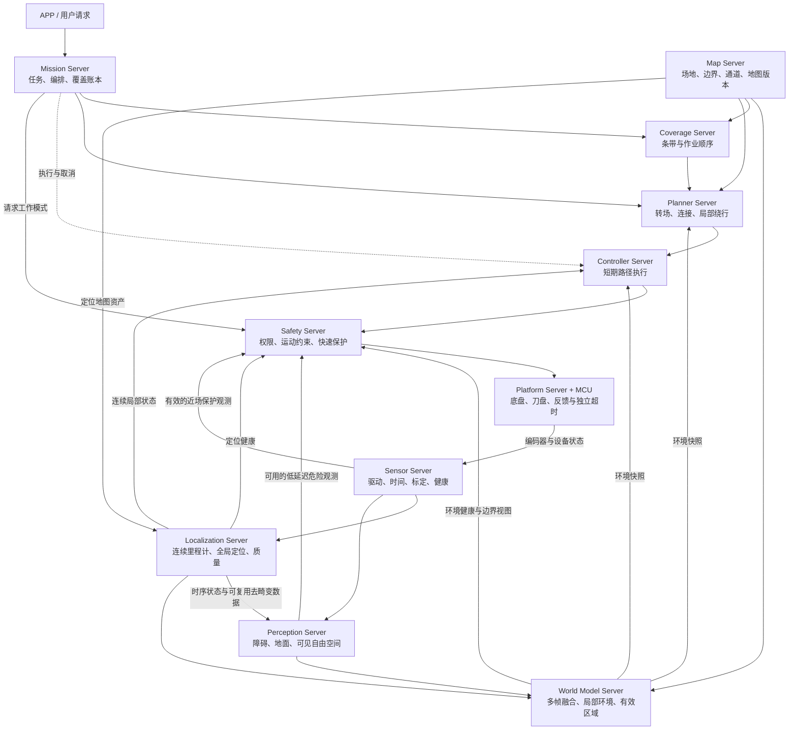

# 割草机器人 Server 架构设计 V1（历史归档）

> 已由《割草机器人算法、数据流与行为调度架构 V2》（同目录 `MOWER_ALGORITHM_ARCHITECTURE_V2.md`）替代。本稿保留供追溯；V2 撤销以 Server 清单为主的组织方式，采用算法组件、行为调度和数据部署三种视图。本文关于 World Model 命名及固定部署分组不再作为推荐基线。

当前架构以 [系统职责](../../SYSTEM_DESIGN.md) 和 [roboframe 架构基线](../ROBOFRAME_ARCHITECTURE_BASELINE.md) 为准，V1 与 V2 均不作为当前实施依据。

设计日期：2026-09-29。状态：历史建议稿，已归档；算法性能、误差界限和保护阈值未经目标硬件及实车验证。

本设计独立于现有代码架构。它借鉴 ROS/Nav2 的职责分离、标准接口和执行服务方式，按割草产品的实际信息流重新划分。文中的 Server 名称、数据契约、状态机、分工和落地阶段均为本方案建议，不是 ROS 官方规范。

已知约束：约 15 人算法团队；产品线 A 为 RTK + 单目/双目 + IMU + 编码器；产品线 B 为固态激光雷达 + 单目 + IMU + 编码器、无 RTK；主控能力覆盖 RK3562—RK3588 范围；差速或 4WD 底盘。4WD 的转向机构未确定，涉及滑移转向的约束仅在该配置成立时启用。

## 1. 架构决策摘要

建议采用 **9 个算法逻辑 Server + 2 个平台边界**。定位负责可信运动状态，感知负责观测解释，World Model 负责跨帧环境估计，Map 负责长期资产；规划与控制消费有质量说明的状态和环境。Mission 管理作业，Safety 统一运动许可与最终命令出口。

其中最重要的组织调整，是为 World Model 指定一名具有定位、时序融合经验的明确负责人。不能把这个模块留成“感知组、SLAM 组和规控组共同负责、最终无人负责”的空白。

五条基线约束：

1. 数据接入同时约定时间、坐标、质量、来源和失效行为；只有数据类型匹配不算接入完成。
2. 一项环境事实只有一个权威维护者。下游可以派生短寿命代价视图，不私自重建另一套障碍历史或全局位姿。
3. 局部连续运动与全局定位校正分别交付；发现或接受重定位时有明确状态迁移，不能只在 pose 中悄悄变化。
4. 环境融合和近场保护走不同延迟路径；前者稳定环境，后者及时响应。两者都必须遵守时间和坐标约定。
5. Server 表示职责、状态与接口边界，不等于单独进程，也不要求所有算法插件化。

## 2. 逻辑结构与主要数据流

图只画主要方向。各 Server 还会向 Mission/Safety 报告状态；Map 接收经验证的地图资产提交；Mission 向 Coverage 提供待作业区域。它不是必须逐级等待的同步调用链。

三种不同地图必须保留职责差异：定位特征地图由 Localization 算法维护；导航环境由 World Model 维护；场地边界、禁区和通道由 Map 管理。它们可以共享校正数据、关键帧引用、几何库和存储，但不强求相同分辨率、内容或更新频率。

## 3. Server 责任清单

| Server | 核心职责及权威状态 | 输入 | 输出 | 明确的职责边界 |
|---|---|---|---|---|
| Sensor Server | 设备接入、采集时间、单位与坐标规范、标定版本、设备健康 | 传感器/底盘原始数据 | 原始观测、时间同步状态、标定配置 | 不判断机器人能否继续作业；不把各驱动强制串到一个转发线程 |
| Localization Server | 连续里程计、全局定位、重定位、局部轨迹历史、定位质量、SLAM 内部地图 | IMU、编码器、RTK、激光/视觉、定位资产 | LocalState、GlobalAlignment、LocalizationStatus、可复用校正数据 | 不负责覆盖进度和一般避障地图 |
| Perception Server | 单帧/短序列视觉与几何解释、可见性、测量质量 | 图像、点云、标定、对应时刻姿态 | 障碍观测、地面/草地、可见自由空间、危险候选 | 不独立维护另一份长期障碍占用图；算法内部跟踪记忆允许存在 |
| World Model Server | 导航环境的时间融合、动态/静态证据、地形、观测有效范围、局部环境快照 | 感知观测、时序位姿、场地图层 | EnvironmentSnapshot、局部风险区域、环境质量、长期变化候选 | 不持有任务策略，不因规划失败就删除障碍事实 |
| Map Server | 场地资产、边界/禁区/通道、地图包与版本、验证后提交 | 用户编辑、建图结果、长期变化候选 | SiteMap、定位资产引用、版本变更事件 | 不运行实时 SLAM 优化，不生成每周期局部障碍图 |
| Coverage Server | 区域分解、条带、转弯/连接几何、作业顺序 | 作业区、工作幅宽、底盘约束、剩余作业区 | CoveragePlan、不可覆盖区域及原因 | 不拥有实际完成账本，不把临时障碍永久改成禁区 |
| Planner Server | 转场、局部绕行、作业段连接、路径可行性与代价策略 | 任务目标、覆盖段、状态、环境、底盘约束 | MotionPlan、失败原因与阻塞范围 | 不重新去畸变、估计位姿或时间融合障碍 |
| Controller Server | 跟踪短期路径、有限的倒退/转向/对接执行能力、执行进度 | MotionPlan、LocalState、环境、运动约束 | MotionRequest、执行反馈 | 不根据原始传感器自行纠正全局定位，不自行选择下一作业区 |
| Mission Server | 任务编排、业务模式、实际覆盖账本、回充/续作、重试预算 | 用户任务、服务器反馈、实际轨迹和刀盘状态 | 各能力请求、任务状态、覆盖记录 | 不参与高频速度保护或底层滤波 |
| Safety Server | 运动控制权、最终速度与刀盘许可、健康降级、快速碰撞保护 | 运动请求、状态健康、保护观测、底盘反馈 | 唯一 AuthorizedCommand、MotionEnvelope、限制原因 | 不自动绕障、不完成任务规划；独立硬件保护在 MCU 层 |
| Platform Server | 底盘/刀盘协议、执行确认、设备反馈 | AuthorizedCommand | 编码器、实测速度、刀盘状态、故障码 | 不接受其他算法模块绕过 Safety 的正式运行命令 |

回充是产品必需能力。V1 可由 Mission 的对接子流程、Perception 的桩检测能力和 Controller 的对接执行器完成；当形成独立闭环、独立负责人或多种桩型后，再提取 Docking Server。提取前后都遵守相同运动权限和失败接口。

## 4. 定位与传感器：先解决时间，再处理几何

### 4.1 局部与全局交付分开

采用 `map → odom → base_link → sensor` 的基本坐标语义。连续的局部运动由 odom 表达；全局位置更新可以纠正 map 与 odom 的关系。该区分来自成熟的 ROS 坐标约定。[REP-105 原文](https://raw.githubusercontent.com/ros-infrastructure/rep/master/rep-0105.rst)

本方案进一步要求：

- Controller 和短期环境融合主要工作在 odom；它连续但仍会漂移，历史保留长度必须受时间、距离和估计质量约束。
- 全局边界、充电桩、作业分区保存在场地 map 坐标；投影到局部时记录所用定位关系与地图版本。
- Localization 同时输出 local_valid 与 global_valid，以及平移、航向、姿态的质量。全局失效不等于局部里程计立即失效，反之亦然。
- 每条 TF 只有一个发布权威；备用定位器输出候选结果，由 Localization 内部选择，不能多个节点同时争用 map→odom。
- 不能用一层低通滤波把错误全局位姿“变平滑”后宣称问题解决。校正应被验证、解释并反馈给消费者。

候选定位质量字段包括：最近有效观测年龄、RTK 状态、创新/残差、跟踪状态、几何退化、航向可观测性、打滑提示、重定位状态、协方差，以及系统实际验证过的误差裕量。小协方差和 RTK FIX 都不能单独构成可靠性证明。

### 4.2 去畸变放在最能保证其正确性的内部链路

推荐将激光运动补偿作为 Localization 前端内的共享能力：Sensor 保留扫描起止时间、逐点采集时间和设备时间映射；前端用扫描期间可用的 IMU/轮速/状态预测完成补偿，并向感知发布带处理标记的校正点云。

依赖顺序是：上一估计状态 + 当前 IMU/轮速传播 → 当前扫描补偿 → 当前扫描匹配/状态更新。不要要求先得到依赖当前点云的最终 pose，才允许该点云完成去畸变。更复杂的内部迭代可以存在，但不能跨 Server 形成同步等待环。

LIO-SAM 的原始实现说明了逐点时间和 IMU 对补偿的作用；这里借鉴数据契约，不指定该算法适用于所有固态雷达。[LIO-SAM 数据准备说明](https://github.com/TixiaoShan/LIO-SAM/blob/master/README.md?plain=1)

工程约束：

- 固态雷达按设备真实扫描模式处理，不套用机械雷达 ring 假设。没有逐点时间或其语义未知时，应明确补偿能力受限。
- 点云携带 raw/deskewed、参考时刻、参考坐标、calibration_revision 和源帧 ID；同一消费者不能再次重复补偿。
- 如果定位前端只保留稀疏特征，不能把稀疏特征云冒充完整避障云；可共享姿态轨迹与补偿库，对必要的感知分辨率执行一次补偿。
- 如果发布校正云的时延超过保护预算，近场保护保留独立的低延迟路径，并明确自己的时间、变换和质量门槛。合理的独立保护计算不应为“消除重复”而删除。
- 相机明确曝光时间和时间戳含义；滚动快门、安装振动、IMU 外参和时间偏移纳入标定验收。V1 可限制工况，不宣称已补偿没有处理的效应。

### 4.3 避免信息重复融合

同一编码器生成的位置与速度、已经包含 IMU 的 LIO 结果和再次输入的同一 IMU，都可能相关。统一传感器来源表和状态估计拓扑，不把相关结果当独立证据反复融合。成熟融合工具也专门提醒重复信息问题。[robot_localization 配置说明](https://github.com/cra-ros-pkg/robot_localization/blob/rolling-devel/doc/configuring_robot_localization.rst)

第一版采用明确的一条主融合链，而不是所有估计器结果再次统一塞进“大滤波器”。系统不要求完整联合概率模型，但必须记录来源、避免明显双计数，并用真实误差校验质量输出。

## 5. World Model：把环境估计变成正式交付物

### 5.1 交付环境事实、质量和有效范围

World Model 接收有对应时刻位姿的观测，在连续局部坐标内完成多帧配准、证据累计、障碍清除及时间失效。V1 以局部二维占用、必要的高度/坡度层、简单动态目标状态为主。三维传感器和六自由度姿态可以用于投影，不要求建设全场景高密度三维世界模型。

| 图层/对象 | 必需表达 | 失效方式 |
|---|---|---|
| 占用 | 占用证据、来源、更新时刻 | 老化到未知或重新观测确认，不直接老化为空闲 |
| 自由空间 | 哪些区域被有效观测为可通行、观测时刻 | 遮挡/过期后不继续当作已确认自由空间 |
| 地形 | 必要的高度、坡度、粗糙度或地面拟合质量 | 地形假设不成立时输出 unknown/invalid |
| 语义 | 草地、硬质地面、人/动物/障碍候选及置信度 | 语义不单独决定几何通行能力 |
| 动态对象 | 位置、可用时的速度、年龄与不确定性 | 短期跟踪，超时保守处理，不永久刻入静态底图 |
| 观测覆盖 | 当前传感器可靠覆盖区域、盲区、数据来源健康 | 决定本周期可用的运动方向和速度 |
| 场地约束投影 | 禁区、外边界、通道及所用定位/地图版本 | 定位关系或地图变更后重新生成 |

概率占用、可见性和多源栅格融合是成熟做法，可以参考 Autoware 的相关组件；本方案不复用其汽车尺度参数或整套架构。[Autoware 占用栅格模块](https://autowarefoundation.github.io/autoware_universe/latest/perception/autoware_probabilistic_occupancy_grid_map/)

地图考虑位姿不确定性也不是新概念。ANYbotics 的历史 elevation_mapping 项目就是相关工程例子，但该项目已不再积极维护，引用仅用于说明思路，不作为本方案的软件选型建议。[项目说明](https://github.com/ANYbotics/elevation_mapping)

### 5.2 融合规则必须覆盖这些反例

| 情况 | V1 处理要求 |
|---|---|
| 单帧出现孤立噪点 | 按测量质量、邻域支持和重复观测调整地图证据；保存来源便于诊断 |
| 近场首次出现可信障碍 | 立即进入保护判断；不等待满足静态障碍的多帧确认门槛 |
| 障碍被遮挡 | 不能因为没检测到就清为空闲 |
| 原障碍移走 | 在该位置被明确看见且有自由空间证据后清除；老化只能逐步降低可信度 |
| RTK 校正但 odom 连续 | 局部相对几何不必全部清空；重新投影全球边界、目标和相关图层 |
| odom 重启或历史运动估计失效 | 局部历史不可沿用；无可靠变换时丢弃重建，不“继续凑合融合” |
| 雷达空包、无效深度或饱和 | 输出无效/未知，不等同于前方无障碍 |
| 无回波或可疑落差 | 结合设备测量模型区分量程外、无效、遮挡、负障碍；不能默认可行驶 |
| 高频重复消息或重放 | 源帧 ID 去重，避免同一证据被反复累计 |
| 相机和激光使用同一位姿 | 不把公共位姿误差当作独立噪声通过融合“平均掉” |

规划器仍可以维护代价缓存、搜索图、轨迹候选和距离查询加速结构。禁止重复的是“以自己的方式再解释一次传感器和历史障碍”，而不是禁止算法拥有内部数据结构。

### 5.3 环境事实与行动代价分开

World Model 负责“这里检测到什么、可信多少、何时观测、哪里未知”。Planner/Controller 负责“在本次任务和底盘能力下，怎么走更合适”。

例如，同一片坡面对于转场、割草和原地掉头可能有不同限制；同一障碍在不同速度下也需要不同余量。因此：

- 机器人真实轮廓、刀盘工作幅宽、几何碰撞函数和运动学参数有统一版本，采用共享库/配置。
- 安全硬约束由共同定义的 MotionEnvelope 和不可穿越区域表达。
- 任务相关的软代价由规划/控制算法消费事实后生成。
- 不确定性裕量、车体尺寸膨胀和算法软代价分别标识，避免 World Model 膨胀一次、Planner 再膨胀一次、Controller 再加一次而无人知晓。
- 通用距离场可以由 World Model 计算一次供多个消费者使用；若分辨率和时效不同，允许有说明的局部派生，先测收益再集中。

## 6. Map：管理长期资产及其一致性

Map Server 管理 SiteMap 包：场地 ID、边界、禁区、通道、桩位、坐标原点、有效标定/机器人配置、定位地图资产引用和 map_revision。定位特征/关键帧的算法更新由 Localization 负责；持久化与加载版本由 Map 协调。

地图修改采用简单的“构建候选 → 验证 → 提交新版本 → 通知消费者”流程。V1 不需要分布式数据库；可用文件包与原子替换的清单，失败时保留上一完整版本。

建图和作业地图分开：建图中允许后台优化候选地图，正式作业锁定一个已验证的版本。不能让正在执行的路径在不知情的情况下使用了新禁区或新坐标原点。

运行中用户新增禁区时，旧许可撤销、检查当前车体位置和可停车空间、重建约束后再规划；如果机器人已经处于新禁区内，不允许自动选择任意方向脱困，须由显式恢复策略处理。

长期地图不能因为看到一次障碍就修改，也不能因为局部观测为空就删掉用户配置的禁区。局部环境与长期地图冲突时保留来源和优先级：用户硬禁区持续生效；实时可信障碍可增加限制；局部自由空间不能解除硬禁区。

## 7. 接口契约：让上下游不必猜

尽量沿用标准点云、图像、IMU、Odometry 等消息。新增契约可以使用少量包装消息或携带源消息 ID 的元数据；不能只靠两个无关联 Topic 的“最新值”拼接。下表是语义约定，不是建议立即实现庞大的消息系统。

### 7.1 所有关键数据必须明确的公共信息

| 信息 | 约定 |
|---|---|
| 时间 | 测量/参考时间与发布时间区分；扫描还记录时间区间；跨设备统一时间域；记录时间同步质量 |
| 坐标 | frame_id、单位、轴向、状态的参考时刻；绝不默认收到时刻等于测量时刻 |
| 来源 | producer、源帧/序号、必要的处理标记；便于去重、回放和识别相关证据 |
| 有效性 | VALID/DEGRADED/INVALID、原因码、有效空间范围、最长允许年龄 |
| 版本 | 只携带有依赖的 map_revision、alignment_epoch、odom_epoch、calibration_revision、robot_config_revision |
| 使用约束 | 外推上限、未知区策略、降级能力，不能靠消费者各自猜测 |

不用给所有消息强加所有版本字段。原始 IMU 不需要 map_revision；全局路径和边界投影需要。各 Server 的会话 ID/启动 ID 用于区分重启后序号重新从零开始。

融合使用统一的测量时间域；本机租约、截止时间和看门狗使用不会随系统校时回跳的单调时钟。不同设备的单调时钟不可直接相减：跨设备命令同时校验约定时间域的源时效、会话/序号及接收端本地超时，MCU 保留本地看门狗。传感器时钟重同步须上报，不通过篡改历史采集时间来隐藏。

### 7.2 核心接口建议

| 数据/动作 | 提供者 → 消费者 | 核心内容 | 消费端必须检查 |
|---|---|---|---|
| LocalState | Localization → World/Planner/Controller/Safety | odom 位姿、速度、姿态、协方差/质量、odom_epoch | 时间新鲜度、局部有效性、epoch、有限数值 |
| GlobalAlignment | Localization → Map/World/Planner/Mission/Safety | map→odom、参考时间、alignment_epoch、全局误差/可观测状态 | 是否适合边界投影、作业记账和全局目标 |
| ObservationBatch | Perception → World | 几何/语义观测、可见范围、自由空间、测量质量、源帧 ID | 观测时间对应的轨迹是否可用、标定、来源去重 |
| EnvironmentSnapshot | World → Planner/Controller/Safety | snapshot_id、局部几何、观测覆盖、图层时间、版本清单、有效区域 | 不能仅检查快照刚发布；每类关键证据是否过期 |
| SiteMap | Map → Localization/World/Coverage/Planner/Mission | 场地图层、资产引用、版本与坐标定义 | 任务绑定的版本、几何有效性 |
| ComputeCoverage | Mission → Coverage | 区域、剩余作业区、幅宽、底盘约束、地图版本 | 返回条带的版本、可执行性与未覆盖原因 |
| ComputeMotionPlan | Mission → Planner | 目标或覆盖段、模式、约束、环境/定位引用 | 目标所属任务是否仍有效、路径与最新硬约束是否兼容 |
| FollowMotionPlan | Mission → Controller；计划来自 Planner | task_id、plan_id、执行代号、局部路径、方向/速度限制、有效期 | 版本、路径新鲜度、地图边界、执行权限 |
| MotionRequest | Controller/遥控 → Safety | 线角速度、来源、权限代号、序号、有效期、刀盘请求 | 当前唯一获准来源、请求时效、健康和硬约束 |
| AuthorizedCommand | Safety → Platform | 审核后命令、许可、有效期、序号 | 超时、重放、来源与执行反馈 |
| CoverageEvidence | Platform+Localization → Mission | 实际位姿、刀盘真实工作状态、宽度配置、定位质量、时间区间 | 不能用计划轨迹代替实际执行；低质量区间标为待确认 |

### 7.3 一致快照不等于全系统同一时刻

World Model 用历史 LocalState 把不同采集时间的观测配准到约定局部坐标，形成不可变快照。快照列出各图层使用的时间、来源、版本与覆盖范围；同一块数据被消费者读取期间不原地改写。

Controller 使用更接近当前时刻的 LocalState 是合理的，只要 odom_epoch 一致、环境年龄在预算内、动态障碍按年龄扩大占用或预测范围。不能为了追求所有消息时间戳相同，让控制器长期使用旧位姿。

Planner 接受一个可复现的快照做规划，但旧快照上生成的计划在执行前、执行中都需对当前环境和硬约束检查。snapshot_id 的作用是追踪依据，不是保证环境永远不变。

正常通信采用 Topic 传数据、Action 执行长任务、Service 完成短配置请求。控制周期不等待远程地图查询或磁盘读取；高频数据使用有界缓存，历史不足时返回无效，不无限阻塞。

## 8. 定位跳变、地图更新与重启协议

三个概念分别表达：

- map_revision：长期场地资产发生提交更新。
- alignment_epoch：全局重定位、全局定位来源切换或影响消费者连续性的校正事件。正常微小连续更新不必每帧增加 epoch，但仍受路径偏移/误差检查约束。
- odom_epoch：局部参考系重置或其连续性失效。

它们不能用一个含义模糊的 reset 标志代替。阈值根据误差预算和下游几何影响定义，不能固定拍脑袋写“跳 20 cm 才处理”。

### 8.1 全局校正事件处理

1. Localization 发现大创新、重定位候选或来源切换，先输出不稳定状态；Safety 立即收紧许可。全局关系若已突变，则即使事件消息延迟，消费者的版本和几何检查也应使当前计划失效。
2. Mission 暂停自动作业和覆盖确认；Controller 进入受控停止；Safety 撤销旧执行权限。停止斜率受物理制动限制，刀盘按设备风险策略停用。
3. Localization 验证并提交新的 GlobalAlignment 和 epoch，给出参考时刻。坐标校正不能只改 TF 而不改质量/版本状态。
4. World Model 保留仍有效的 odom 局部相对环境，重投影边界与全局图层；Planner 作废受影响的计划。
5. Mission 将受影响时间段的覆盖证据置为待确认。单次当前位姿校正不足以修正整个历史轨迹，必要时保守补割。
6. World、Planner、Controller 报告已使用新版本且可运行；Safety 同时确认机器人已停、数据新鲜、许可条件满足，再授予新的执行代号。
7. 任一步超时或失败都保持停止/受限状态，给出原因；不以定时器到期作为自动恢复成功。

V1 用带版本的状态发布、动作取消和“依赖就绪”条件即可，不需要复杂分布式事务。不能依赖多个 Topic 到达顺序天然一致。

关键消费者以带 epoch 的 GlobalAlignment 为全局变换依据，同一计算周期锁定这份关系；TF 用于兼容与可视化时也应能追溯到它。禁止从最新 TF 取变换、再从另一条延迟状态流取旧 epoch 拼成一份“有效输入”。新旧关系不一致时先使相关能力不可用。

### 8.2 其他事件的最小响应

| 事件 | 需要失效的数据 | 可以保留的数据 |
|---|---|---|
| 单纯全局定位校正 | map 投影、受影响路径、待确认覆盖证据 | 同一 odom_epoch 中仍新鲜的局部相对环境 |
| odom 重置 | 局部地图历史、局部执行路径、运动权限 | 完整长期地图资产、已可靠确认的历史任务结果 |
| 场地地图换版 | 依赖旧资产的规划/定位/边界数据，按变更范围验证 | 原始传感器记录、连续局部运动状态 |
| 标定变更 | 受该标定影响的观测及融合历史 | 与之无关的场地业务数据 |
| 控制器或 Safety 重启 | 所有旧运动权限及执行代号 | 只读地图；任务检查点仅作为恢复依据 |
| 时钟回跳/时间同步失效 | 时序缓存和受影响融合结果 | 有完整时间语义的持久资产 |

SLAM 闭环可能非刚性调整历史子地图。不能用一个刚体 map→odom 变换修复所有历史几何。V1 在建图模式生成新地图包、验证后切换；正式作业期间避免悄悄改写已发布地图几何。以后确需在线非刚性更新，再引入子地图版本和重投影能力。

## 9. 两条传感器产品线如何共享架构

上层接口保持语义一致；不同配置声明能力、有效范围和失效条件。不能以一个空点云或永远为零的障碍图假装补齐缺失能力。

| 内容 | A1：RTK + 单目 | A2：RTK + 双目 | B：固态激光 + 单目，无 RTK |
|---|---|---|---|
| 连续局部状态 | IMU + 轮速，按必要性和算力增加视觉约束 | IMU + 轮速，可加入视觉里程计 | 激光惯性/轮速约束前端；低算力下需验证是否达到预算 |
| 全局定位 | RTK 接入全局估计，质量受遮挡、多路径和初始化影响 | 同 A1 | 相对已建场地地图的定位、重定位和闭环管理 |
| 障碍几何 | 单目测距能力依赖具体方法及适用条件，必须单独验证 | 有效视差生成度量深度；低纹理、曝光和遮挡处降级 | 固态雷达范围内的几何距离；近场、低矮物和背向盲区单独验证 |
| 草地/地面语义 | 单目语义，不能直接推导三维自由空间 | 语义与有效深度结合 | 视觉语义与激光几何结合 |
| World Model | 根据可用几何证据建图；无法确认的区域保持未知 | 占用 + 必要地形层 | 占用 + 必要地形层，注意窄视场与转弯覆盖 |
| 主要脆弱场景 | RTK 遮挡、单目尺度/地面假设失效、航向初始化 | RTK 遮挡、低纹理草地、逆光、双目失配 | 空旷草地几何退化、相似场景、雷达盲区、重定位失败 |

A1 的单目草地分割并不等于可靠距离测量。基于标定和地面假设的投影、时序几何或学习深度都可以作为具体方案评估，但都必须输出自己的适用范围与质量。产品要求的速度、障碍尺寸和保护距离超过它的有效能力时，需要减少运行范围或补充感知能力；不能靠接口设计解决不可观测问题。

单天线 RTK 在静止时也不直接提供可靠车体航向。初始化需要经过验证的来源或动作；未经授权的“先开出去走一段再说”不能作为通用启动流程。

B 产品线的“global”可以只是某个场地内的 map 坐标，不要求有地理坐标。抬起搬移后必须重新定位并重新判断是否在作业区；没有足够特征时应报告不可用，而不是只凭轮速恢复。

### 9.1 能力声明与在线健康分开

产品配置固定声明：传感器几何覆盖、是否有度量深度、倒车观测范围、定位来源、允许地形、底盘转向形式、工作幅宽和最大速度等。在线状态再说明“当前哪些能力可用”。

例如“安装了双目”是产品配置，“当前左相机失联”是在线健康；“支持后退”是底盘能力，“当前后方可观测距离不足”是本周期限制。

Safety 将当前观测距离、定位质量、地形和底盘能力转换为 MotionEnvelope。Mission 只根据这一结果决定等待、回充或终止，不针对每种相机型号散布条件判断。

### 9.2 差速与 4WD 的共同接口

Controller 对外处理机体运动，Platform 根据实际底盘模型映射驱动命令。共享 RobotModel 描述 footprint、轮距/轴距、方向、转弯约束、速度/加速度、工作幅宽和坡地限制。

若 4WD 为滑移转向：轮速不等于真实机体运动；里程计模型和噪声需适配，打滑时降低轮速约束可信度。Planner 避免草坪上的不必要原地旋转，Controller 接收曲率/转向限制，Safety 结合姿态和实测行为限制运动。算法分别处理估计、规划和保护，但共享同一底盘配置版本。

户外坡地保留 roll/pitch 等三维姿态供投影、重力补偿和风险判断。可以用二维路径规划，不能因此把整个估计与感知系统强制压成平地假设。

## 10. 任务、规划、控制及作业账本

### 10.1 Mission 采用状态机主线，复杂子流程再选行为树

建议主状态：IDLE、PREPARING、TRANSIT、MOWING、PAUSED、RETURNING、DOCKING、CHARGING、COMPLETED、FAULT。RELOCALIZING/RECOVERING 可以先作为受控子流程，不必把所有动作组合成巨型状态枚举。

Mission 是任务状态唯一维护者。算法 Server 只报告执行状态和原因；Safety 独立决定运动是否被允许。三者不要共用一个含义不清的“机器人状态”。

典型业务：准备与定位检查 → 获取地图版本 → 生成覆盖计划 → 转场到首段 → 跟踪作业段 → 更新实际覆盖 → 剩余区域计划 → 低电回充 → 对接确认 → 续作。

### 10.2 Coverage 与 Planner 的连接

Coverage 输出条带、段方向、推荐顺序、边缘作业区、转弯/连接几何和未覆盖区域。Planner 根据当前环境验证连接与转场；遇到临时障碍时输出局部修复，不能悄悄大幅改变覆盖策略。

如果绕行影响工作条带：Planner 报告被跳过的范围；Mission 更新待补作业区；Coverage 在受影响区域重算。不要在每次小绕行后重新生成整个场地覆盖计划。

V1 路径平滑作为 Planner 内部步骤，执行前统一校验几何、曲率、障碍和边界。不新增 Smoother Server。场地通道网络先作为 Planner 内部模块，确需独立图路由能力后再拆 Route Server。

### 10.3 Controller 执行的是有约束、有版本的短期计划

V1 采用几何路径 + 分段速度/方向限制即可，不强求全局严格时间参数化轨迹。按底盘特性选择成熟的跟踪算法，保持局部障碍检查、偏差与进度检查。

- 全局路径在统一定位关系下转换为短期 odom 执行段，由 Planner 的路径处理组件负责；正常关系变化受几何偏差门槛检查。
- Safety 限速或停止后，Controller 接收实际许可/实测速度，进行积分抗饱和或等效处理，不能持续积累控制误差并在恢复时突然冲出。
- 计划过期、版本变化、观测失效、长时间无进展分别报告不同原因。
- 接受新计划不意味着原计划已经停止；执行切换使用明确代号和状态确认。

### 10.4 覆盖账本由实际证据更新

Mission 维护：未作业、已确认作业、待确认、临时阻塞、不可达等状态。证据至少包含实际轨迹、有效刀盘状态、时间、工作幅宽、地图版本和定位质量。

“已确认作业”表示系统根据执行证据确认有效工作足迹经过，不等于直接测量每根草已被切断。刀盘堵转、转速异常或高度不合适时不能仅以开关请求为真继续记账。

对位姿和幅宽不确定的区间，采用经验证的保守工作足迹或标为待确认，避免产生虚假的全覆盖。剩余区域可通过少量重叠补割处理，不把所有误差压到追求极限跟踪精度上。

用检查点 + 有限追加证据保存任务。启动后校验地图版本、当前位置和刀盘状态再恢复；中断处理按稳定的 evidence_id/段 ID 去重，不能把消息重复接收当成重复完成任务。

## 11. Safety、异常恢复与运动所有权

### 11.1 单一正式命令出口

自主控制、遥控、对接、脱困等只能发布 MotionRequest。Safety 维护当前 owner 与执行代号，授予有限有效期的权限；Platform 在正式运行模式下只消费 AuthorizedCommand。

切换控制权：撤销旧权限 → 请求停止 → 根据实测速度确认已停或满足受控切换条件 → 授予新代号。旧消息即使稍后到达，也因代号、时效或序号不符而被拒绝。紧急停止不等待上层 Action 的取消完成。

动作取消必须区分：已收到取消、已撤销运动权、已确认物理停止。不能收到 Action cancel ACK 就认为机器已经停下。

软件链路建议：控制请求 → 常规限速/加减速约束 → 最终保护与许可 → Platform。最终保护之后不能再由普通平滑器延缓紧急停机。Nav2 对碰撞监控位于速度后处理末端的要求提供了对应参考。[Collision Monitor 接线原则](https://docs.nav2.org/rolling/tutorials/general_tutorials/using_collision_monitor/using_collision_monitor/)

Safety 自身失联时，Platform/MCU 通过独立命令超时进入预定义停止状态；抬升、急停等需要的设备联锁由硬件/嵌入式链路落实。此处是职责设计，并不构成任何安全认证结论。

### 11.2 用能力许可描述降级

MotionEnvelope 至少包含：是否允许驱动、是否允许刀盘、允许方向、速度/角速度和加减速限制、有效期、限制原因。V1 可用四种对外可理解模式：NORMAL、LIMITED、STOP、LATCHED_FAULT。

| 条件 | 默认行为 | 恢复条件 |
|---|---|---|
| 局部运动状态无效/过期 | 停止驱动与作业 | 新状态可信、时间链稳定、重新授予执行权限 |
| 全局定位失效但局部仍有效 | 暂停割草和全球覆盖确认；仅在已验证的局部约束及边界余量下允许有限动作 | 全局关系恢复并重新验证路径/边界 |
| 环境数据过期或关键方向无观测 | 限制对应方向，余量不足则停止 | 恢复有效观测，不能只等节点心跳正常 |
| 新鲜近场危险观测 | 立即约束或停止；记录来源 | 危险解除且达到恢复稳定条件 |
| 4WD 打滑或姿态风险 | 降速/停止，避免加大控制量硬顶 | 运动质量恢复或进入显式脱困流程 |
| 抬升、翻转、急停或关键驱动故障 | 锁存相应故障，刀盘/驱动按风险策略停止 | 满足设备复位与人工确认条件 |

降级准入需要有实测误差和可停车范围依据。V1 没有经过验证的“失去全球定位还能继续多久”策略时，默认停止自动作业；不能用统一固定秒数代替场景判断。

恢复有滞回、连续有效窗口和重试上限，避免质量在阈值附近抖动造成反复启停。严重锁存故障不能被一般“恢复正常”消息自动解除。

### 11.3 保护距离从延迟与底盘能力推导

初始工程预算可写为：

`需要的净空 >= v × τ + v² / (2 × a_min) + 位置/感知误差裕量 + 额外余量`

其中净空从车体外轮廓计量；τ 是从相关测量采集到制动生效的端到端时延，不能只取算法运行时间；a_min 是指定坡度、地面、载荷下实测的可保证减速度。旋转和曲线运动还要检查扫掠轮廓。该式是预算入口，不替代动力学与实车制动验证。

定位误差增大时，边界约束也需要增加裕量；即使附近没有几何障碍，也不能继续靠近虚拟外边界。机体轮廓、定位裕量和测量裕量需明确各自承担部分，避免漏算或重复累计。

### 11.4 谁处理失败

Server 先判断本模块能否在既定预算内重试，并返回原因、受影响能力、重试建议和上下文。Mission 决定业务后续；Safety 可以随时限制运动。

建议初始原因码：TIME_SYNC_INVALID、STATE_STALE、LOCALIZATION_UNCERTAIN、RELOCALIZING、OBSERVATION_STALE、MODEL_NOT_READY、MAP_VERSION_CHANGED、NO_FEASIBLE_PATH、PATH_BLOCKED、NO_PROGRESS、CONTROL_LIMITED、DRIVE_FAULT、BLADE_FAULT、CANCELED。

例如 NO_PROGRESS 可能来自打滑、Safety 持续限速、障碍阻塞或控制问题，必须附最近的限制来源。不要遇到所有导航失败就清代价地图和重启定位。清除临时历史须有来源与范围，不得顺便删除用户禁区。

## 12. RK3562—RK3588：按能力裁剪，先测预算再承诺配置

不能仅按芯片型号或 NPU 标称算力承诺同时运行某套 SLAM、深度和语义模型。DDR、相机链路、驱动、模型支持算子、温度降频和点云规模都影响结果。下面给出实现方向与初始测量目标，均不是现有硬件的实测结果。

### 12.1 两档计算配置，共用契约

| 能力 | 较低算力配置优先策略 | 较高算力配置扩展 |
|---|---|---|
| 状态估计 | 一条主融合链；前端限点/限特征；RTK 方案先评估是否确需视觉里程计 | 更丰富的视觉/激光约束、有限后台优化 |
| 图像感知 | 一套主要网络共享骨干或结果；降分辨率、限制推理频率；按任务启用桩检测 | 更高分辨率/频率、经验证的深度或多任务模型 |
| 环境 | 小范围滚动占用图，必要的少量地形层 | 更大范围、更细地形、动态目标跟踪 |
| 全局地图 | 边界、通道与必要定位资产；稀疏或分块加载 | 增加有明确用途的全局环境图层 |
| 规划 | 覆盖按需计算，转场/局部修复事件触发 | 更复杂代价和更多候选评估 |
| 后台任务 | 建图优化、诊断压缩错峰进行 | 在前台预算允许时增加后台任务 |

传感器产品线和计算档位是两个独立配置维度。无 RTK 激光方案如果在低档主控上不能满足前端和保护预算，应判定该组合尚不成立；不得通过隐藏延迟或放宽有效性检查勉强上线。

### 12.2 推荐初始执行预算

| 链路 | 初始目标范围，用于设计压测 | 关键观测项 |
|---|---|---|
| IMU 接入/传播 | 跟随设备实际采样，常见设计范围 100–400 Hz | 丢包、时间偏移、积分间隔，不强求网络逐帧转发 |
| LocalState | 50–100 Hz 起步 | 状态年龄、预测跨度、抖动，不能靠重复发布旧估计凑频率 |
| Controller | 20–50 Hz 起步 | 周期完成时间、输入年龄、实际执行延迟 |
| Safety | 50–100 Hz 周期监督 + 危险事件触发 | 端到端制动延迟、最坏调度间隔 |
| 视觉/环境融合 | 5–15 Hz 起步，取决于速度和观测预算 | 测量到使用的时延、有效覆盖范围、每层证据年龄 |
| 局部规划 | 事件触发 + 有界周期检查 | 规划完成时的环境年龄、取消响应 |
| Coverage / 地图持久化 | 按任务或版本事件触发 | 不阻塞控制；时间和内存峰值受限 |

这些频率只作为初始试验点。验收核心是最坏时延、物理制动距离和场景可观测性，不是 Topic 看起来有多少 Hz。p99 可用于定位性能问题，但不能代替保护截止时间的保证；实际超时由许可与硬件看门狗处理。

内存示例：12 m × 12 m、5 cm 分辨率是 57,600 个栅格；每格 20 字节约 1.15 MB，双缓冲约 2.30 MB。这只是栅格数组，不含模型、点云、图像、索引、运行时与历史缓存。应把大头逐项实测，不能用这个数字估算整机内存。

### 12.3 初始部署建议

先以约六个主要故障/调度域评估，必要的厂商驱动进程另计：

| 域 | 内容 | 目的 |
|---|---|---|
| 定位域 | Localization，相关高频前端 | 保证 IMU/里程计处理不被图像推理或地图保存阻塞 |
| 感知域 | Perception，NPU 推理 | 隔离推理峰值与模型异常 |
| 环境域 | World Model + Map 接口，持久化使用受控后台任务 | 共享环境状态；磁盘 I/O 不锁住实时融合 |
| 自主任务域 | Mission + Coverage + Planner | 高耗时规划工作放独立有界工作队列，保持取消和状态处理可响应 |
| 控制域 | Controller | 与规划耗时隔离；订阅本地只读快照 |
| 执行保护域 | Safety + Platform | 最终命令出口独立于规划和感知计算；MCU 另设看门狗 |

Sensor Server 是统一的驱动接口与配置边界，不要求所有驱动一个进程，也不做所有数据的中心拷贝站。

低档平台可以在性能测量后组合定位/感知等部分节点；高档平台也无需按 Server 数量拆成十几个进程。保护与规划故障隔离应保留。

传感器队列有界，按时效丢弃过期批次并报告丢弃数；IMU/编码器不能简单用“只取最新”丢掉积分期间的数据。地图/配置可以可靠交付，传感器传输策略根据容忍丢包和积压代价选择。通信 QoS、时间戳和应用层超时需要一起验证。

线程优先级、进程组合或共享内存均是后续测量驱动的优化。它们不能修复算法内部长时间持锁、错误时间语义或无界工作队列。

## 13. 共享计算清单与不应强行共享的部分

| 计算/数据 | 权威位置 | 下游使用方式 |
|---|---|---|
| 标定、时间偏移、机器人尺寸 | Sensor/Platform 配置，版本化 | 统一配置加载和只读查询，不各写一份常数 |
| 位姿历史、全局定位关系 | Localization | 有界订阅缓存或同进程只读接口；消费者不另建融合器 |
| 激光去畸变 | Localization 前端或其共享补偿组件 | 发布明确标记的点云/轨迹；避免重复处理同一产品 |
| 深度与语义模型结果 | Perception | 多个下游复用结果，检测/分割不因消费者不同各跑一遍 |
| 地面几何、观测自由空间 | Perception | 带质量和可见区域的 ObservationBatch |
| 导航环境的多帧融合 | World Model | 不可变 EnvironmentSnapshot |
| 持久地图包和几何边界 | Map | 版本化资产；消费者可缓存只读派生结构 |
| 车体几何、坐标工具、碰撞几何原语 | 小型共享库 | 统一语义，按各自时间预算本地计算 |
| 实际覆盖记录 | Mission | Coverage 消费剩余区域，不自行再建完成账本 |

允许有理由的独立计算：定位用特征选取与避障用完整几何不同；控制器的最终轨迹可行性复核与规划器搜索不同；Safety 的近场保护与 World Model 时间融合不同。衡量重复的标准是“是否重复估计同一个事实并产生分歧”，而不是“是否调用过两次相同几何函数”。

不建设一个跨进程、每次碰撞查询都要 RPC 的万能 Collision Server。共享低成本几何库通常更直接；昂贵且通用的环境预处理才集中维护。

运行管理由集成层用现有启动/生命周期工具承担，不再新增万能 Runtime Server。启动顺序先建立 MCU/Safety 的禁止运动状态，再准备设备与标定、地图资产、局部估计、感知和环境，最后满足任务所需的全局定位与运动准入。进程存活、节点 Active、输出数据可用是三个不同条件。

重启依赖模块后重新检查对应版本和质量；不能只因节点恢复心跳就自动续跑。配置变更分为可在线调整的软代价和需要停机重建的标定/模型/硬约束；V1 为后者采用停止、校验、重新启动相关链路的简单流程。

## 14. 15 人团队的责任分配

建议保留大家熟悉的算法专业方向，但以 Server 的交付物和整机故障场景验收。以下是 15 人的主责分配示例，不要求成立七个行政小组。

| 主责 | 人数 | 主要交付 |
|---|---:|---|
| 系统负责人 / 任务架构 | 1 | Mission、跨模块契约、整机模式与异常决策、设计取舍 |
| 定位与传感器几何 | 3 | Localization、时间/标定接口、两产品线定位与质量评估 |
| 感知 | 3 | 单目/双目/激光观测、语义、自由空间、模型部署与质量 |
| 环境与地图 | 2 | World Model、Map；至少一人熟悉时序配准与估计误差 |
| 规划控制 | 3 | Coverage、Planner、Controller 与底盘约束 |
| 系统集成与执行保护 | 2 | Safety、Platform/Sensor 接入集成、调度与硬件联调 |
| 回放与系统验证 | 1 | 数据集、故障注入、契约验收、性能回归 |
| 合计 | 15 | 固件、硬件、APP 等协作资源另行明确 |

环境团队不是最后接收各组结果的“清洗组”。它需要参与定位、感知接口评审；感知和定位组仍对自己输出的误差、时延和失效识别负责。

每个关键接口指定生产方 owner 和消费方 reviewer。接口验收包含正常数据、质量变差、过期、重启、版本变化五类情况。规控无需掌握所有 SLAM 推导，但必须理解 local/global 的差别；感知无需实现控制器，但必须理解采集时间、可见性与制动预算。

跨模块问题的整机闭环负责人由系统负责人指定。根因定位后由生产方修复输出、消费方补齐必要校验；不能仅在下游添加临时滤波就关闭问题。

## 15. 可验证性：故障场景比框图更重要

所有关键决策携带 task_id、plan_id、snapshot_id、依赖版本、执行代号和原因码。有限环形记录保留故障前后的原始观测、状态、环境、命令、实际反馈与标定配置；高带宽原始数据按存储预算采样，不必全时无上限保存。

回放时可查看同一时刻的原始观测、校正观测、环境快照、位姿质量、计划、Safety 限制与实际运动。优先做一套能查清责任的可视化与日志，不建设独立大型观测平台。

| 验收场景 | 注入/工况 | 必须观察到的架构行为 |
|---|---|---|
| 全局位置/航向校正 | 作业中注入不同方向和幅度校正 | 旧执行权限失效；无异常控制尖峰；边界重新投影；可疑覆盖不确认 |
| 小但持续的全局偏移 | 多次低于单次事件门槛的校正 | 累积几何偏差仍触发路径/边界检查，不能绕过 epoch 策略 |
| odom 重置 | 定位前端重启 | 局部历史与路径失效，不融合到旧局部图 |
| 全局重定位失败 | 无 RTK 产品抬起搬移至相似区域 | 不自动恢复旧任务执行；显式报告全局不可用 |
| 时间偏移/乱序 | 相机/雷达时间误差、延迟包、时钟回跳 | 质量降级或丢弃；原因可追溯；不静默用最新 pose 配准旧帧 |
| 旧数据重新盖新时间 | 节点持续发布同一帧 | 通过源 ID/测量时间识别；不能假健康 |
| 去畸变缺失/重复 | 标记或逐点时间错误 | 接口校验/回放发现，不在下游靠障碍膨胀掩盖 |
| 刚出现的障碍 | 运动方向突然出现可信障碍 | 快速保护先响应，静态地图确认随后进行 |
| 噪点与草叶扰动 | 孤立回波、抖动语义、阴影 | 环境稳定性提升；保护误停和漏检分别统计，不能只追求平滑 |
| 障碍移走和遮挡 | 移走一个物体，再遮挡原位置 | 显式自由空间才清除；遮挡不会清成可走 |
| 空包/无效深度 | 双目全无效或雷达掉包 | Unknown/Invalid 与“无障碍”区分 |
| 地形与负障碍 | 坡面、沟边、台阶、草遮挡 | 地面假设失效可见，运动范围受限，不把无回波当自由空间 |
| 单目能力不足 | 逆光、低纹理、地面投影不成立 | 范围/能力降级；上层不依赖伪造的度量地图 |
| 4WD 打滑 | 湿草、横坡或原地转向 | 轮速质量调整、控制受限、覆盖不虚增，脱困次数受控 |
| CPU/NPU/热压力 | 大点云、推理变慢、温度降频 | 队列有界；控制/保护截止时间监测生效，后台让出资源 |
| 保存地图时控制 | 磁盘慢、写满、写入失败 | 不阻塞控制；保留上一完整资产，错误上报 |
| 地图换版/新增禁区 | 路径执行中修改边界 | 旧路径不继续获准；新约束生效前限制运动 |
| 控制源竞争 | 自主、遥控、恢复交错请求 | 唯一 owner；旧/乱序/过期命令不执行 |
| 取消后迟到结果 | Planner 在任务取消后返回成功 | task_id/执行代号检查拒绝采用 |
| Safety 限速长时间持续 | 人工制造持续限制 | 控制不积分饱和后冲出；Mission 能辨认限制来源 |
| Safety/Controller 崩溃 | 进程退出或线程卡死 | Platform/MCU 超时停止；重启不恢复旧许可 |
| 刀盘故障 | 请求开但实测未工作或堵转 | 停止相应作业，覆盖账本不记假完成 |
| 断电续作 | 不同阶段断电与恢复 | 检查点可恢复；先校验位置/地图/设备，再进入任务 |
| 两产品线切换 | 保持上层任务与接口测试不变 | 对不支持的能力明确拒绝/降级，避免大量传感器专用上层分支 |

验收指标包括：定位真实误差与质量声明的关系；静态障碍位置稳定性；动态危险响应时延；自由空间误清率；漏割/重割与覆盖确认误差；路径跟踪误差；实际停车距离；端到端时延和超时次数；重启/取消后的错误动作次数；内存/温度/算力峰值。

阈值按产品速度、刀盘幅宽、边界精度、最小障碍、坡地和允许误停率确定。当前信息不足以给出可信的厘米级误差、可用率或帧率承诺。本表是待实现的验收方案，不表示已完成仿真或实车验证。

## 16. 按风险和依赖推进的落地顺序

### 阶段 A：统一契约和测量条件

先选一条主产品线和一台底盘作为基线。确定采集时间/标定/坐标、LocalState 与 GlobalAlignment、质量与版本、唯一运动出口、关键日志。制作定位校正、观测延迟、节点重启三个最小回放场景。

退出条件：消费者能正确拒绝无效输入；定位跳变不被当成机体瞬移；旧命令不能在重启后执行。此时不追求最优覆盖效率。

### 阶段 B：形成可依赖的局部环境

完成 Perception → World Model 的多帧链路，规划/控制消费相同事实快照，打通低延迟保护。记录一次同源点云从采集到最终使用的完整时序，消除最明显的重复补偿和重复融合。

退出条件：静态物体在局部环境中稳定；噪点、移动、遮挡和过期行为符合契约；算力与内存有可解释预算。

### 阶段 C：闭合割草业务

完成覆盖、转场、跟踪、遇障跳过/补割、回充和续作；实际刀盘与轨迹更新覆盖账本。建立地图修改、定位校正和任务中断的统一处理。

退出条件：完整任务成功率、真实覆盖与记录一致性可衡量；失败能归因到具体 Server 或接口；不存在靠重启碰运气的无限恢复。

### 阶段 D：第二传感器线与低算力档

替换定位/感知实现，复用同一组核心契约和业务场景。按实测裁剪观测分辨率、环境范围、后台工作与算法，而不裁剪失效语义和命令保护。完成差速/实际 4WD 底盘分别验证。

退出条件：上层只依赖能力与健康；产品配置无法达到关键预算时有明确的不支持结论；异常用例在目标主控上通过。

不建议所有组同时开发新接口后到最后总集成。每阶段都交付可运行的纵向链路。阶段日期取决于现有算法成熟度、数据、底盘和嵌入式支持，本设计不将人数直接换算成工期。

## 17. 第一版明确保留与暂缓的内容

必须保留：时空与质量契约；局部/全局定位区分；独立环境融合责任；地图版本；规划执行的失效条件；运动权限；实际作业账本；有界计算与基本回放。

暂缓：全局稠密三维重建作为导航前提；统一大模型或端到端策略；全系统联合概率推理；全部算法插件化；跨进程高频几何 RPC；单独的 Route/Smoother/每种恢复动作 Server；复杂分布式事务；在线无约束热切换定位器；未验证误差预算下的长期失定位继续割草。

以后拆分 Server 的条件是出现独立状态生命周期、明显不同的时延/资源需求、多个调用者或稳定的独立负责人，而不是函数数量增加。

## 18. 设计审查结论与待决项

本稿已按以下架构问题自查并补充处理：去畸变与定位循环依赖、全局跳变导致局部图污染、旧路径版本竞态、重复证据融合、平滑延缓保护、单目伪度量能力、4WD 打滑、未知区误清、取消与物理停止混淆、依赖心跳掩盖旧数据、环境模块过度集中、低算力积压、覆盖虚假完成。

当前没有对本方案开展运行时测试；也没有检查或修改原有算法实现。以下参数须在产品与实车评审中定稿：

| 待决项 | 决定什么 | 建议负责人 |
|---|---|---|
| 工作速度、最小障碍、边界和覆盖精度目标 | 时延、分辨率、制动和定位裕量 | 系统负责人 + 产品 + 验证 |
| 具体传感器、同步方式、镜头/雷达安装 | 观测范围、时间误差与几何可观测性 | 定位 + 感知 + 硬件 |
| 实际 4WD 转向机构与地形范围 | 里程计模型、控制与草坪损伤约束 | 规控 + 定位 + 底盘 |
| 两档主控的内存、散热与驱动条件 | 合法产品组合及算力预算 | 集成 + 感知 + 定位 |
| 抬升/碰撞/急停/刀盘联锁与 MCU 能力 | 软件和硬件故障处理边界 | 集成 + 嵌入式 + 硬件 |
| 定位失效时允许的动作及重定位流程 | 降级与恢复状态机 | 系统负责人 + 定位 + Safety |
| 地图编辑权限、建图与作业模式 | 地图提交和版本切换策略 | 系统负责人 + 环境地图 |
| 单目配置的度量几何与危险检测能力 | A1 产品的运行边界及是否需补充传感器 | 感知 + 系统负责人 |

可以立即定下的设计是职责、数据契约、唯一写入者、故障协议和验证方式；必须通过测量定下的是算法组合、频率、阈值、资源预算和产品能力承诺。
